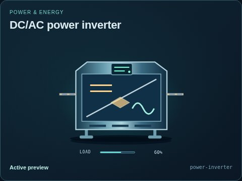
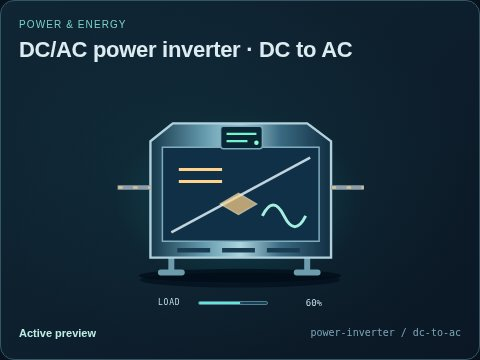
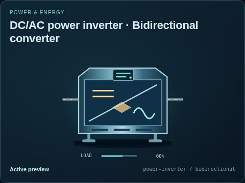

# DC/AC power inverter

[Parent map](../README.md) · [Package owner](../../../../../README.md) · [Image gallery](../../../../README.md)

Generated previews from canonical equipment artwork and supplied illustrative state. Images do not run a process model. Open a preview for its full size.

| File | Preview | Equipment and supplied state |
| --- | --- | --- |
| [default.jpg](default.jpg) |  | DC/AC power inverter Fixed illustrative preview `power-inverter` |
| [dc-to-ac.jpg](dc-to-ac.jpg) |  | DC to AC Fixed illustrative preview `power-inverter` / `dc-to-ac` |
| [bidirectional.jpg](bidirectional.jpg) |  | Bidirectional converter Fixed illustrative preview `power-inverter` / `bidirectional` |
