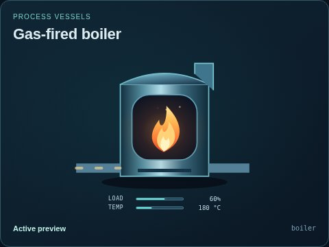
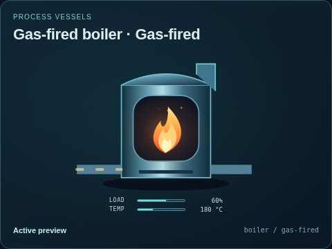
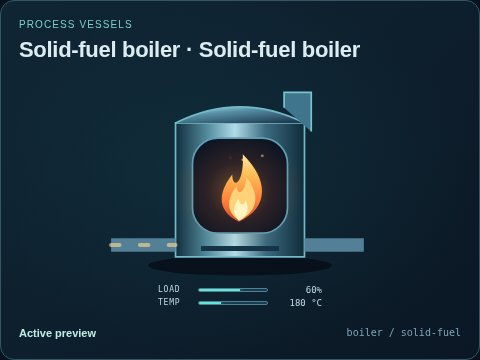
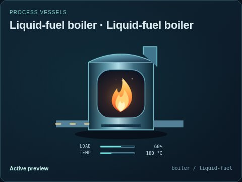

# Gas-fired boiler

[Parent map](../README.md) · [Package owner](../../../../../README.md) · [Image gallery](../../../../README.md)

Generated previews from canonical equipment artwork and supplied illustrative state. Images do not run a process model. Open a preview for its full size.

| File | Preview | Equipment and supplied state |
| --- | --- | --- |
| [default.jpg](default.jpg) |  | Gas-fired boiler Fixed illustrative preview `boiler` |
| [gas-fired.jpg](gas-fired.jpg) |  | Gas-fired Fixed illustrative preview `boiler` / `gas-fired` |
| [solid-fuel.jpg](solid-fuel.jpg) |  | Solid-fuel boiler Fixed illustrative preview `boiler` / `solid-fuel` |
| [liquid-fuel.jpg](liquid-fuel.jpg) |  | Liquid-fuel boiler Fixed illustrative preview `boiler` / `liquid-fuel` |
