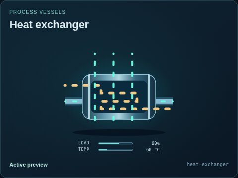
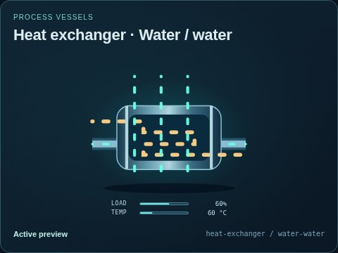
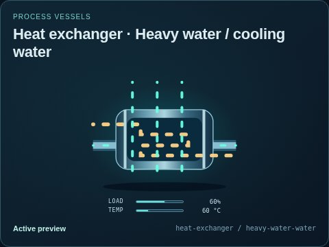
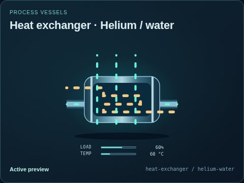
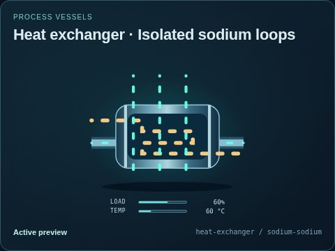
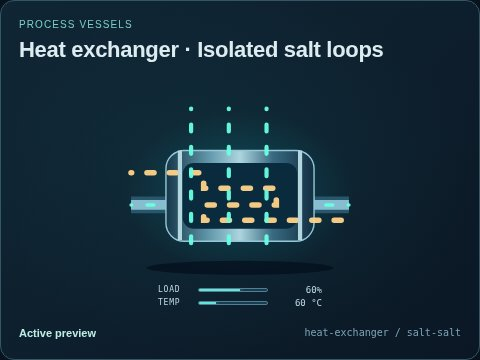
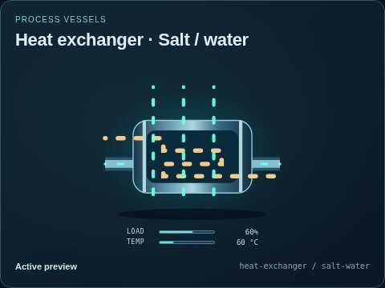
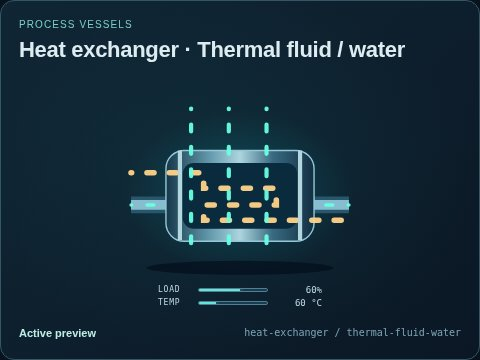
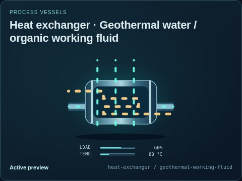

# Heat exchanger

[Parent map](../README.md) · [Package owner](../../../../../README.md) · [Image gallery](../../../../README.md)

Generated previews from canonical equipment artwork and supplied illustrative state. Images do not run a process model. Open a preview for its full size.

| File | Preview | Equipment and supplied state |
| --- | --- | --- |
| [default.jpg](default.jpg) |  | Heat exchanger Fixed illustrative preview `heat-exchanger` |
| [water-water.jpg](water-water.jpg) |  | Water / water Fixed illustrative preview `heat-exchanger` / `water-water` |
| [heavy-water-water.jpg](heavy-water-water.jpg) |  | Heavy water / cooling water Fixed illustrative preview `heat-exchanger` / `heavy-water-water` |
| [helium-water.jpg](helium-water.jpg) |  | Helium / water Fixed illustrative preview `heat-exchanger` / `helium-water` |
| [sodium-sodium.jpg](sodium-sodium.jpg) |  | Isolated sodium loops Fixed illustrative preview `heat-exchanger` / `sodium-sodium` |
| [salt-salt.jpg](salt-salt.jpg) |  | Isolated salt loops Fixed illustrative preview `heat-exchanger` / `salt-salt` |
| [salt-water.jpg](salt-water.jpg) |  | Salt / water Fixed illustrative preview `heat-exchanger` / `salt-water` |
| [thermal-fluid-water.jpg](thermal-fluid-water.jpg) |  | Thermal fluid / water Fixed illustrative preview `heat-exchanger` / `thermal-fluid-water` |
| [geothermal-working-fluid.jpg](geothermal-working-fluid.jpg) |  | Geothermal water / organic working fluid Fixed illustrative preview `heat-exchanger` / `geothermal-working-fluid` |
