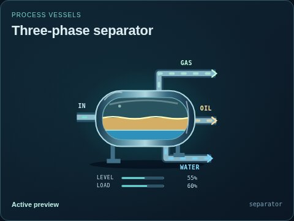
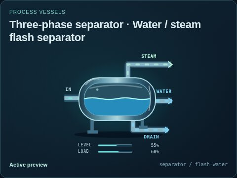

# Three-phase separator

[Parent map](../README.md) · [Package owner](../../../../../README.md) · [Image gallery](../../../../README.md)

Generated previews from canonical equipment artwork and supplied illustrative state. Images do not run a process model. Open a preview for its full size.

| File | Preview | Equipment and supplied state |
| --- | --- | --- |
| [default.jpg](default.jpg) |  | Three-phase separator Fixed illustrative preview `separator` |
| [flash-water.jpg](flash-water.jpg) |  | Water / steam flash separator Fixed illustrative preview `separator` / `flash-water` |
