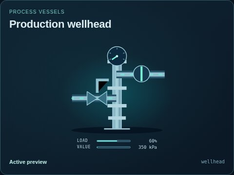
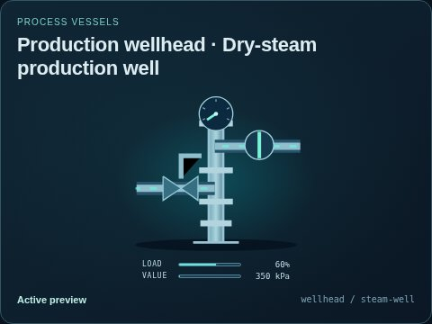
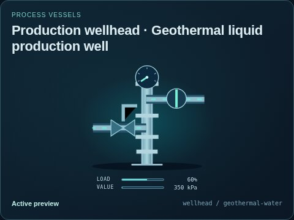

# Production wellhead

[Parent map](../README.md) · [Package owner](../../../../../README.md) · [Image gallery](../../../../README.md)

Generated previews from canonical equipment artwork and supplied illustrative state. Images do not run a process model. Open a preview for its full size.

| File | Preview | Equipment and supplied state |
| --- | --- | --- |
| [default.jpg](default.jpg) |  | Production wellhead Fixed illustrative preview `wellhead` |
| [steam-well.jpg](steam-well.jpg) |  | Dry-steam production well Fixed illustrative preview `wellhead` / `steam-well` |
| [geothermal-water.jpg](geothermal-water.jpg) |  | Geothermal liquid production well Fixed illustrative preview `wellhead` / `geothermal-water` |
