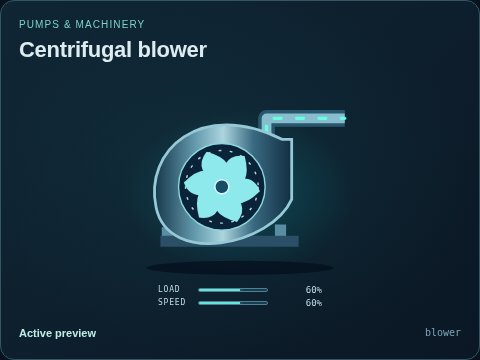
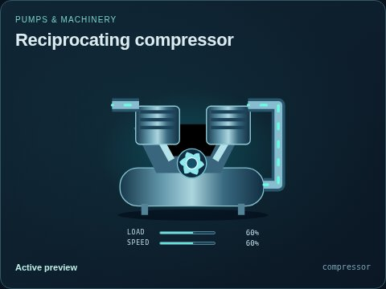
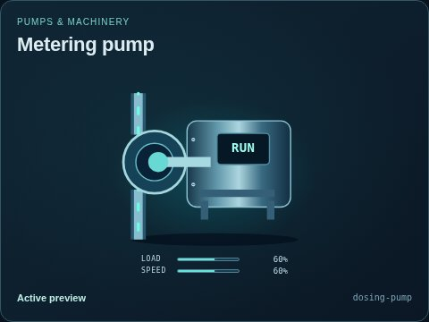
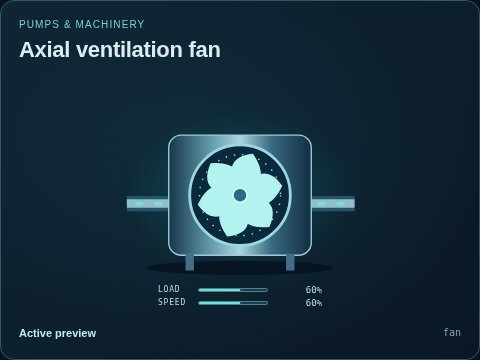
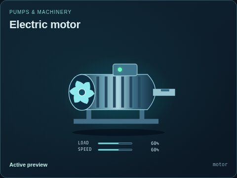
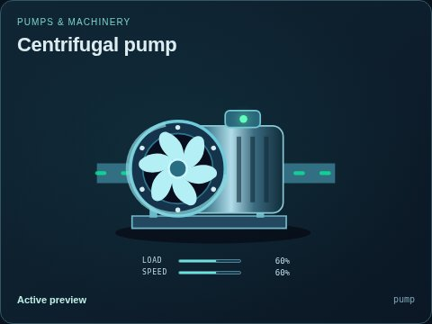
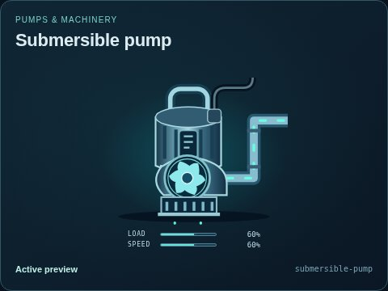

# Pumps & machinery

[Parent map](../README.md) · [Package owner](../../../../README.md) · [Image gallery](../../../README.md)

Generated previews from canonical equipment artwork and supplied illustrative state. Images do not run a process model. Open a preview for its full size.

| Folder | Previews | Example |
| --- | ---: | --- |
| [Centrifugal blower](blower/README.md) | 2 |  |
| [Reciprocating compressor](compressor/README.md) | 1 |  |
| [Metering pump](dosing-pump/README.md) | 1 |  |
| [Axial ventilation fan](fan/README.md) | 1 |  |
| [Electric motor](motor/README.md) | 1 |  |
| [Centrifugal pump](pump/README.md) | 9 |  |
| [Submersible pump](submersible-pump/README.md) | 9 |  |
