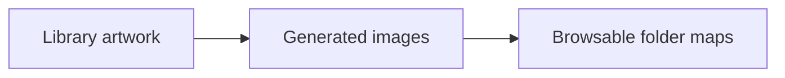
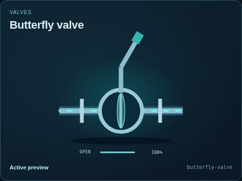
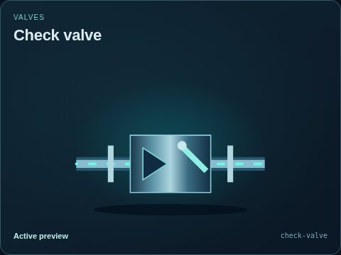
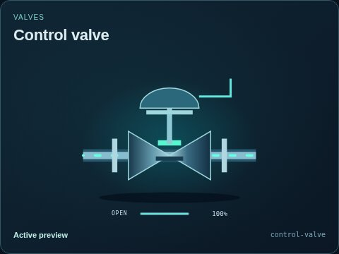
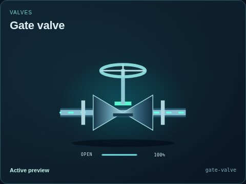
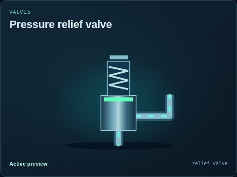

# Valves

[Parent map](../README.md) · [Package owner](../../../../README.md) · [Image gallery](../../../README.md)

Generated previews from canonical equipment artwork and supplied illustrative state. Images do not run a process model. Open a preview for its full size.

| Folder | Previews | Example |
| --- | ---: | --- |
| [Butterfly valve](butterfly-valve/README.md) | 9 |  |
| [Check valve](check-valve/README.md) | 9 |  |
| [Control valve](control-valve/README.md) | 9 |  |
| [Gate valve](gate-valve/README.md) | 9 |  |
| [Pressure relief valve](relief-valve/README.md) | 9 |  |
