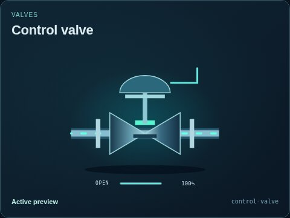
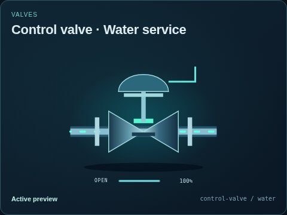
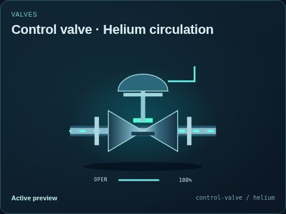
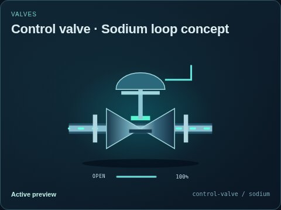
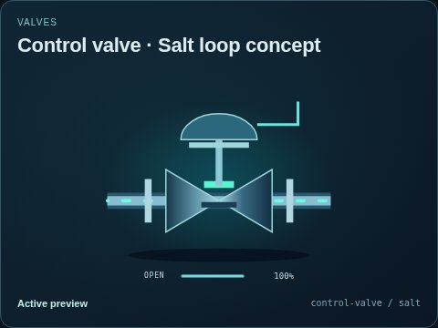
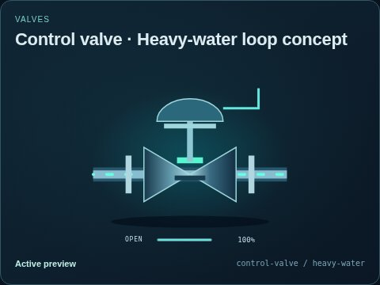
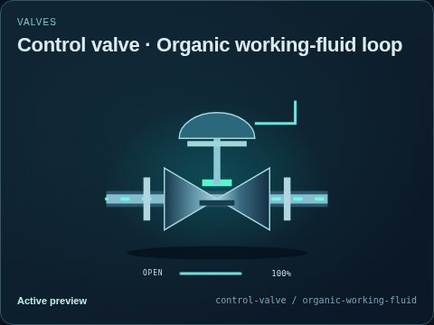
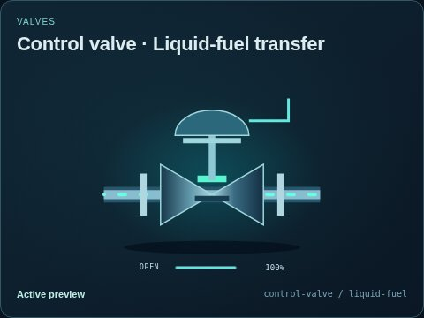

# Control valve

[Parent map](../README.md) · [Package owner](../../../../../README.md) · [Image gallery](../../../../README.md)

Generated previews from canonical equipment artwork and supplied illustrative state. Images do not run a process model. Open a preview for its full size.

| File | Preview | Equipment and supplied state |
| --- | --- | --- |
| [default.jpg](default.jpg) |  | Control valve Fixed illustrative preview `control-valve` |
| [water.jpg](water.jpg) |  | Water service Fixed illustrative preview `control-valve` / `water` |
| [thermal-fluid.jpg](thermal-fluid.jpg) |  | Heat-transfer fluid Fixed illustrative preview `control-valve` / `thermal-fluid` |
| [helium.jpg](helium.jpg) |  | Helium circulation Fixed illustrative preview `control-valve` / `helium` |
| [sodium.jpg](sodium.jpg) |  | Sodium loop concept Fixed illustrative preview `control-valve` / `sodium` |
| [salt.jpg](salt.jpg) |  | Salt loop concept Fixed illustrative preview `control-valve` / `salt` |
| [heavy-water.jpg](heavy-water.jpg) |  | Heavy-water loop concept Fixed illustrative preview `control-valve` / `heavy-water` |
| [organic-working-fluid.jpg](organic-working-fluid.jpg) |  | Organic working-fluid loop Fixed illustrative preview `control-valve` / `organic-working-fluid` |
| [liquid-fuel.jpg](liquid-fuel.jpg) |  | Liquid-fuel transfer Fixed illustrative preview `control-valve` / `liquid-fuel` |
