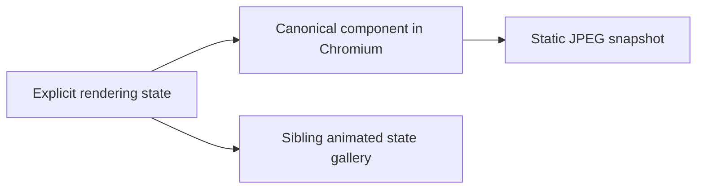
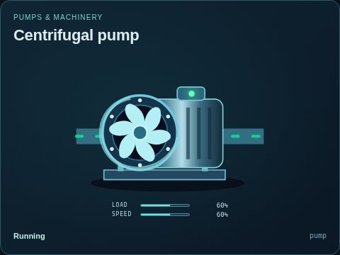
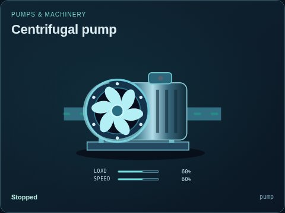
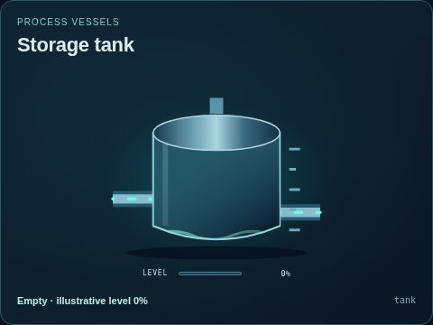
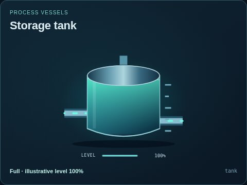
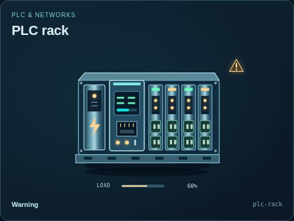
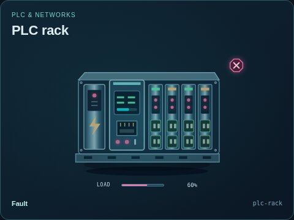

# Static visual state snapshots

[Parent capture map](../README.md) · [Image gallery](../../README.md) · [Package owner](../../../README.md) · [Animated state comparisons](../../states/README.md)

These JPEGs preserve selected visual states for Markdown viewers without SVG animation. They are illustrative renderer inputs, not separate process simulations. The [capture manifest](../../../metadata/thumbnails.json) records their source and image hashes; the animated state gallery provides a wider set of editable examples.

| Comparison | Preview |
| --- | --- |
| Pump running / stopped |   |
| Tank empty / full |   |
| PLC warning / fault |   |

The owning UI capture command is `npm run thumbnails`; use `npm run thumbnails -- --check` for read-only freshness checks. Do not edit the image files. Extend the capture definitions when a new static comparison is useful, then keep this authored folder map aligned.
