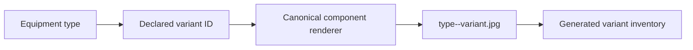
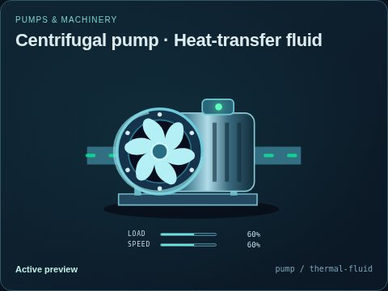
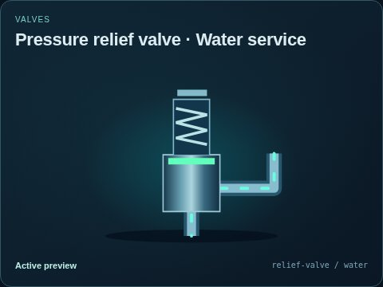

# Equipment variant snapshots

[Parent capture map](../README.md) · [Image gallery](../../README.md) · [Package owner](../../../README.md) · [Complete variant inventory](../../../docs/VARIANTS.md)

Each `<type>--<variant>.jpg` is a real browser capture of a declared equipment variant. The generated inventory lists every current variant with its thumbnail and normalized field inputs; the [animated family gallery](../../symbols/README.md) presents the same selections as portable SVGs.

| Sample | Preview |
| --- | --- |
| Thermal-fluid pump |  |
| Water relief valve |  |

Variant selection changes declared appearance and port semantics; simulation capacities and physical assumptions belong to the host model. See the [capture manifest](../../../metadata/thumbnails.json) for image provenance. Regenerate using `npm run thumbnails`, then check with `npm run thumbnails -- --check`. This folder map is authored; the inventory and images are generated.
