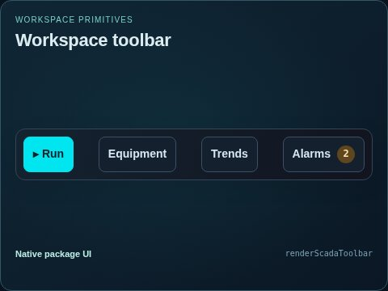
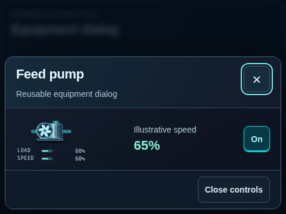
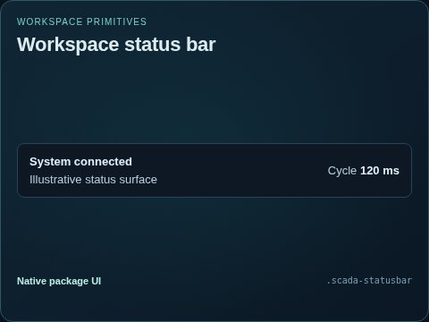
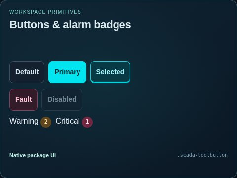
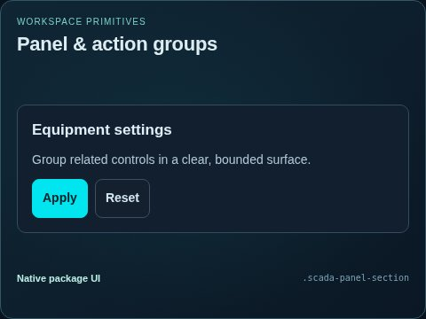
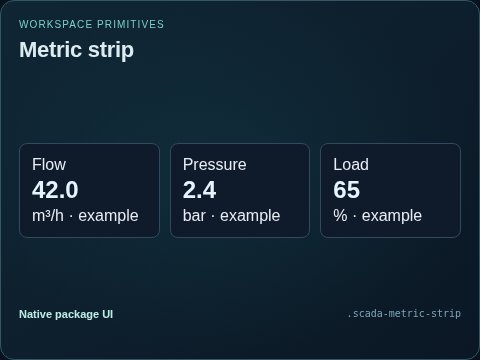
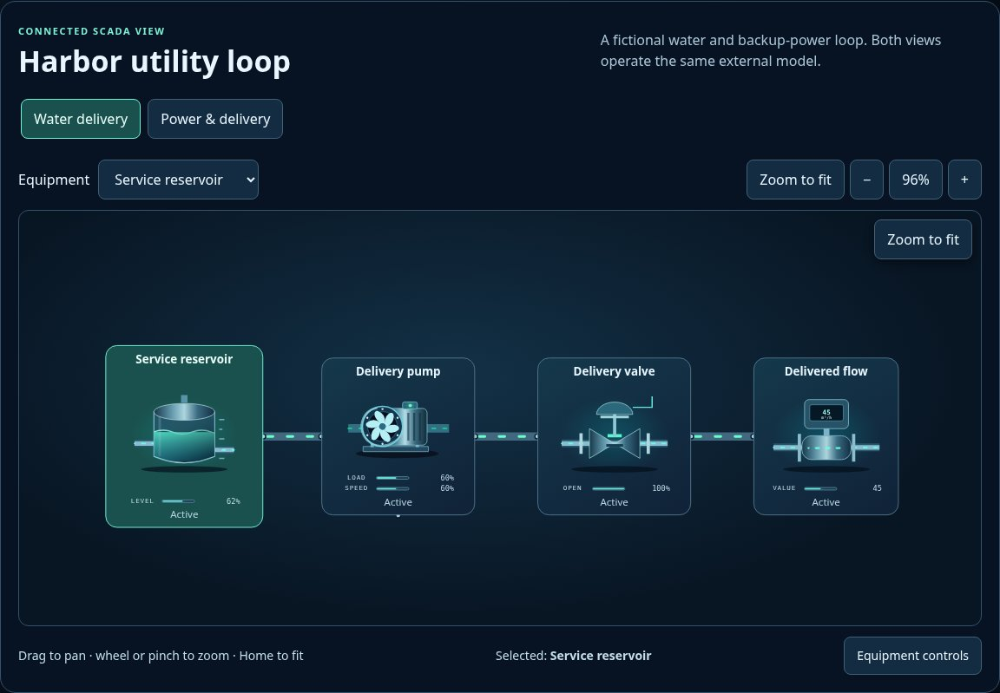

# Workspace

[Parent map](../README.md) · [Package owner](../../../README.md) · [Image gallery](../../README.md)

Generated previews from canonical equipment artwork and supplied illustrative state. Images do not run a process model. Open a preview for its full size.

| File | Preview | Equipment and supplied state |
| --- | --- | --- |
| [toolbar.jpg](toolbar.jpg) |  | toolbar Fixed illustrative preview |
| [dialog.jpg](dialog.jpg) |  | dialog Fixed illustrative preview |
| [statusbar.jpg](statusbar.jpg) |  | statusbar Fixed illustrative preview |
| [buttons.jpg](buttons.jpg) |  | buttons Fixed illustrative preview |
| [panels.jpg](panels.jpg) |  | panels Fixed illustrative preview |
| [metrics.jpg](metrics.jpg) |  | metrics Fixed illustrative preview |
| [generic-viewer.jpg](generic-viewer.jpg) |  | Generic shared-system viewer Fixed illustrative preview |
