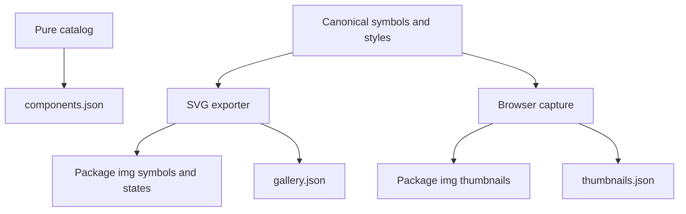

# Portable metadata and image receipts

[Package map](../README.md) · [Pure catalog source](../src/catalog/README.md) · [Gallery](../img/README.md) · [Generators](../../../../../../tools/webkit/scada/ui/README.md)

These JSON files let applications and agents discover equipment and verify exported previews without importing DOM code. They are generated projections of package-owned sources and images; none is a second editable equipment registry.

| File | Contents | Owner |
| --- | --- | --- |
| [components.json](./components.json) | Package identity, category list and component descriptors, including fields and variants. | [build-metadata.mjs](../../../../../../tools/webkit/scada/ui/build-metadata.mjs), from the pure catalog. |
| [gallery.json](./gallery.json) | Animated symbol/state outputs, exact supplied poses, source/output hashes and image export evidence. | [SVG gallery tools](../../../../../../tools/webkit/scada/ui/gallery/README.md). |
| [thumbnails.json](./thumbnails.json) | JPEG equipment/variant/state previews, workspace/viewer captures, capture settings and hashes. | [Thumbnail tooling](../../../../../../tools/webkit/scada/ui/README.md). |

Use the exported `@valpatel/scada-ui/metadata` module for live pure discovery and `@valpatel/scada-ui/metadata.json` for the packaged JSON snapshot. See [the API](../docs/API.md) and [package export map](../package.json) before choosing a path. Every asset path remains owned by this package's `img/`.

Regenerate with the owning [scripts](../../../../../../tools/webkit/scada/ui/README.md), then check source/output hashes. A valid image receipt proves the captured source identity; it does not prove state semantics, physical accuracy or live deployment. The separately reviewed [state coverage JSON](../docs/state-coverage.json) belongs in `docs/`, because it records a design review rather than generated discovery metadata.

