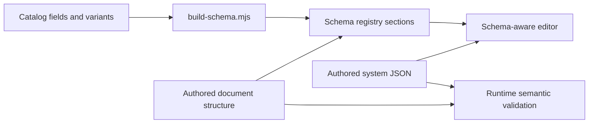

# System document schema

[Package map](../README.md) · [System format](../docs/SYSTEM_FORMAT.md) · [Contract source](../src/contracts/README.md) · [Minimal example](../examples/minimal-system.json)

[scada-system.schema.json](./scada-system.schema.json) contains the JSON Schema draft 2020-12 document structure and catalog-derived registry sections for `format: "scada-system"`, version 1. It describes presentation documents: equipment, connections, views, bindings, controls and assumptions. It is a project format, not an industrial control protocol or a process-model language.

Schema validation catches document shape and declared bounds. The runtime [system validator](../src/contracts/system-definition.mjs) also checks registry state fields, ports, IDs, references and binding paths. Consumers should run runtime validation before mounting a viewer; a schema-valid document alone does not prove a meaningful plant or a supported physical model.

The generator reads this schema and synchronizes type/variant choices plus state/binding properties from the catalog; it preserves the broader document structure. Coordinate structural edits with the runtime validator and format guide, and use the [schema tooling](../../../../../../tools/webkit/scada/ui/README.md) for catalog-derived sections. From this package directory, `npm run build:schema` writes it and `npm run check:schema` checks it. Do not hand-edit registry-derived sections or change the document version to match an unrelated package/model release.

