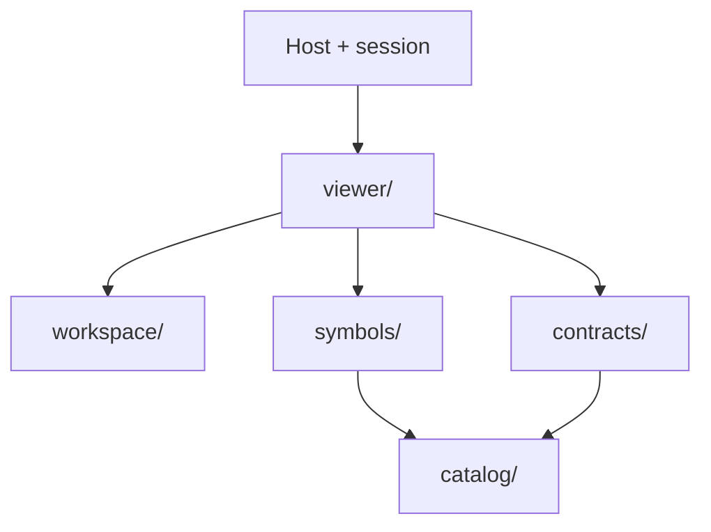

# SCADA UI source map

[Package map and public API](../README.md) · [Documentation](../docs/README.md) · [Examples](../examples/README.md)

The package separates data contracts, equipment artwork, interaction primitives and diagram controllers. The host owns simulation, authorization, persistence and IO. Public exports point directly to the domain implementations below. Agents and validators can read the pure catalog without loading a viewer.

| Owner | Responsibility |
| --- | --- |
| [catalog](./catalog/README.md) | Pure descriptors, state normalization, facets and variant selection; no artwork or browser lifecycle. |
| [contracts](./contracts/README.md) | Versioned JSON definition validation and snapshot bindings. |
| [symbols](./symbols/README.md) | Pure SVG/HTML render functions and scoped CSS animation. |
| [workspace](./workspace/README.md) | Dialogs, keyboard/focus handling, toolbars and teardown. |
| [viewer](./viewer/README.md) | Diagram layout, contained pan/zoom camera, selection, equipment inspector and adapter commands. |
| [index.mjs](./index.mjs), [metadata.mjs](./metadata.mjs), [styles.css](./styles.css) | Public aggregate entries. |

Import the actual dependency owner, keeping catalog and contracts independent of renderer/controller code. The package export map points directly to these implementations. Metadata generation changes data outputs only; package consumers use the browser-ready source tree without a build. The site compiler exposes this owner at `/kit/scada/ui/`.

## Entry points and nearby contracts

Consumer imports come from the [package export map](../package.json). `index.mjs` is the public aggregate; `metadata.mjs` offers pure discovery without a DOM or model session. `styles.css` composes the package skin. Domain modules contain the implementations; there are no historical path wrappers.

Use the [schema map](../schema/README.md) for document validation, [generated metadata](../metadata/README.md) for portable discovery and [state coverage](../docs/STATE_COVERAGE.md) for verified state behavior and open design work. A new SCADA view should share an external adapter rather than fork the host's model or clock. Future non-SCADA viewers may reuse interaction primitives, but their domain contracts and geometry should remain explicit.

