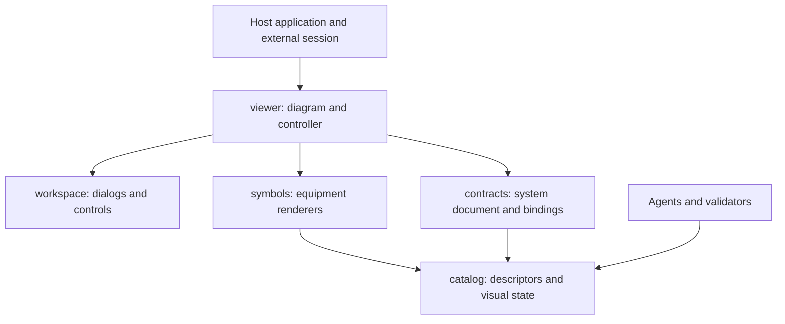
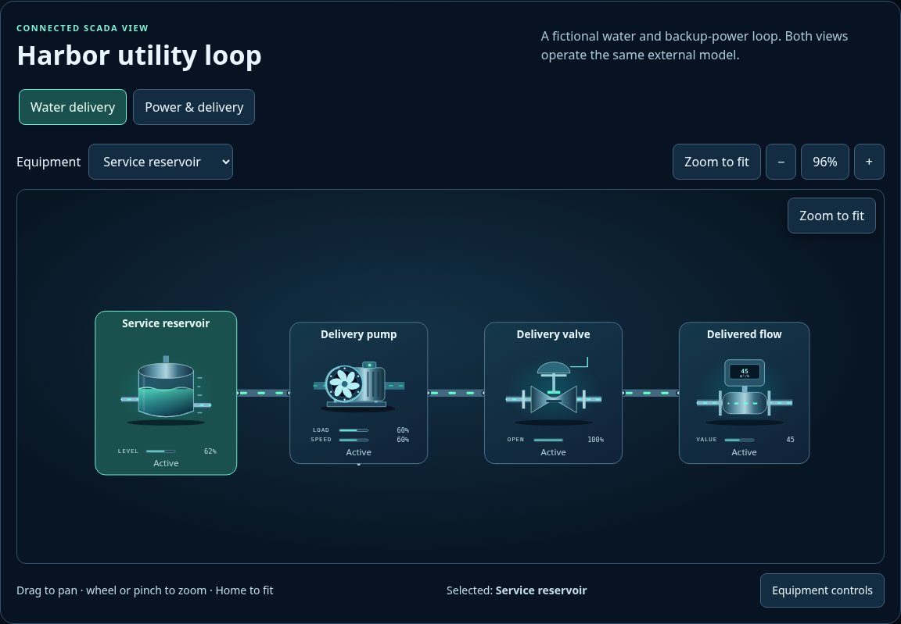

# SCADA UI source map

[Package map and public API](../README.md) · [Documentation](../docs/README.md) · [Examples](../examples/README.md)

The package separates data contracts, equipment artwork, interaction primitives and diagram controllers. The host owns simulation, authorization, persistence and IO. Existing flat entries remain thin compatibility facades for npm exports, downloaded kits and deployed URLs; new implementation belongs in the domains below.

| Owner | Responsibility |
| --- | --- |
| [catalog](./catalog/README.md) | Pure descriptors, state normalization, facets and variant selection; no artwork or browser lifecycle. |
| [contracts](./contracts/README.md) | Versioned JSON definition validation and snapshot bindings. |
| [symbols](./symbols/README.md) | Pure SVG/HTML render functions and scoped CSS animation. |
| [workspace](./workspace/README.md) | Dialogs, keyboard/focus handling, toolbars and teardown. |
| [viewer](./viewer/README.md) | Diagram layout, contained pan/zoom camera, selection, equipment inspector and adapter commands. |
| [index.mjs](./index.mjs), [metadata.mjs](./metadata.mjs), [styles.css](./styles.css) | Public aggregate entries. |
| Flat `scada-*`, `twin-art.*`, `system-definition.mjs` | Compatibility entry points. They forward to the owners above and contain no implementation. |

Do not import a compatibility facade from a new internal implementation. Import the actual dependency owner, keeping catalog and contracts independent of renderer/controller code. Do not move a public entry without a versioned consumer migration. The site composer projects this tree under `packages/scada-ui/`, preserving package-local facade paths; historical root website module URLs are not retained. `build:library` generates metadata only. Packaged consumers use this source tree directly without a build.

## Entry points and nearby contracts

Consumer imports come from the [package export map](../package.json). `index.mjs` is the public aggregate; `metadata.mjs` offers pure discovery without a DOM or model session. `styles.css` composes the package skin. Historical flat modules forward to the domain owners listed above; they are not alternate implementations.

Use the [schema map](../schema/README.md) for document validation, [generated metadata](../metadata/README.md) for portable discovery and [state coverage](../docs/STATE_COVERAGE.md) for verified state behavior and open design work. A new SCADA view should share an external adapter rather than fork the host's model or clock. Future non-SCADA viewers may reuse interaction primitives, but their domain contracts and geometry should remain explicit.

