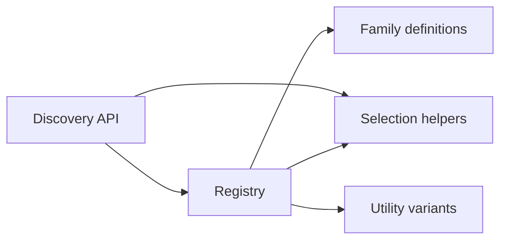

# Equipment contracts and discovery

[Source map](../README.md) · [Package map](../../README.md) · [Metadata outputs](../../metadata/README.md) · [Definitions](./definitions/README.md)

This domain contains pure data contracts. It can be imported for agent discovery, validation and selection without mounting a DOM, starting a model or loading SVG artwork.

| Source | Responsibility |
| --- | --- |
| [registry.mjs](./registry.mjs) | Assemble immutable descriptors, resolve type/variant selection and normalize declared visual state. |
| [discovery.mjs](./discovery.mjs) | Public filtering/facets over the assembled catalog. |
| [selection.mjs](./selection.mjs) | Shared pure taxonomy, data-object validation, variant merging and query helpers. |
| [utility-variants.mjs](./utility-variants.mjs) | Explicit utility carrier and circuit compatibility variants. |
| [definitions/](./definitions/README.md) | Industrial, power and agriculture metadata, fields, ports and provenance. |

Keep this layer independent of symbols, workspace, viewer, model sessions and host code. A field range or capacity preset is a presentation/discovery contract, not a verified equipment rating. The simulation package owns separate versioned model descriptors and checks catalog parity explicitly. Compatibility variants may reuse geometry; see [variants](../../docs/VARIANTS.md) and [state coverage](../../docs/STATE_COVERAGE.md).

