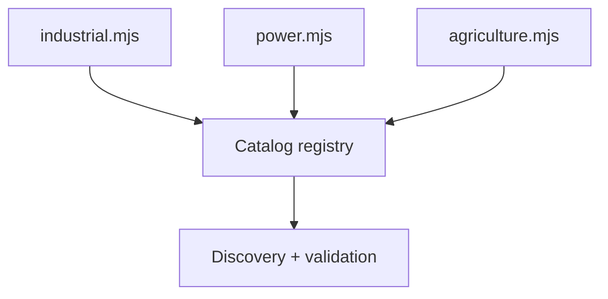

# Family metadata definitions

[Catalog map](../README.md) · [Source map](../../README.md) · [Package map](../../../README.md) · [Gallery families](../../../img/symbols/README.md)

| Source | Declares |
| --- | --- |
| [industrial.mjs](./industrial.mjs) | Manufacturing/process additions, typed fields and reusable damage profiles. |
| [power.mjs](./power.mjs) | Energy, grid and nuclear descriptors; circuits, variants, technology/fuel facets and capacity presets. |
| [agriculture.mjs](./agriculture.mjs) | Growing, aquaculture and climate descriptors, fields and provenance. |

Keep identity, state fields, ports and assumed provenance here; put geometry in [symbols](../../symbols/README.md) and dynamics in the external model. Some baseline descriptors remain assembled in `registry.mjs`; this directory is not a second complete registry. Shared damage/variant metadata can inform artwork without importing that artwork back into the catalog.

Declare only supported states. A new field needs a meaningful rendering or explicit readout-only rationale and model mapping/limit documentation; consult [state coverage](../../../docs/STATE_COVERAGE.md) before claiming completeness.

