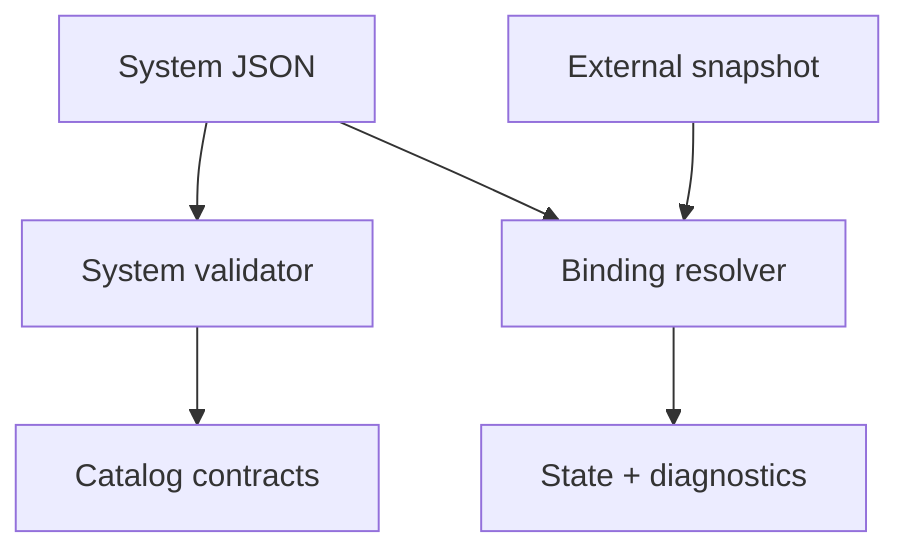

# System document contract

[Source map](../README.md) · [Package map](../../README.md) · [System format](../../docs/SYSTEM_FORMAT.md) · [Schema map](../../schema/README.md)

[system-definition.mjs](./system-definition.mjs) is the sole implementation in this domain. It validates presentation documents and resolves explicit snapshot bindings. The package system-definition export points directly to this file.

| Export | Responsibility |
| --- | --- |
| `validateSystemDefinition` | Check document shape, registry fields/ports, IDs, bounds, views and cross-references. |
| `resolveBinding` | Read an explicit JSON Pointer from a supplied snapshot; no evaluated expressions. |
| `resolveComponentState` | Combine an equipment instance's state and declared bindings with missing-data diagnostics. |
| `SYSTEM_DEFINITION_VERSION` | Version the presentation document independently of package/model versions. |

The contract does not fetch URLs, acquire credentials, execute commands, mount UI or create a model. Those remain host responsibilities. Start a new document from [the minimal example](../../examples/minimal-system.json), then validate it before passing it to [the viewer](../viewer/README.md). JSON Schema complements these semantic checks; it does not replace them.

## Files

| File | Purpose |
| --- | --- |
| [system-definition.mjs](system-definition.mjs) | System validation, bindings and view resolution. |
