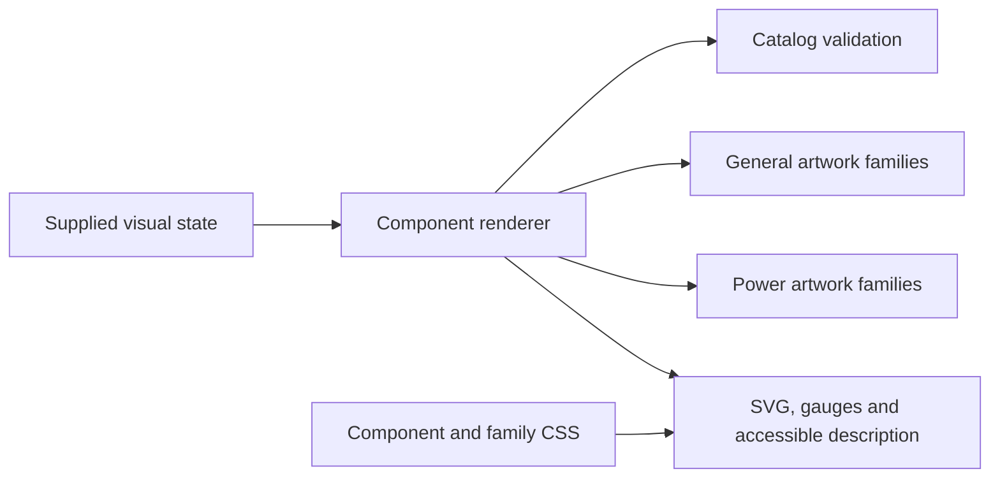

# Equipment symbol rendering

[Source map](../README.md) · [Package map](../../README.md) · [Style guide](../../STYLE_GUIDE.md) · [Gallery](../../img/README.md)

| Owner | Responsibility |
| --- | --- |
| [components.mjs](./components.mjs) | Normalize supplied visual state, choose artwork and compose escaped accessible markup, gauges and condition cues. |
| [components.css](./components.css) | Standalone skin, shared state gates and imports of family animation styles. |
| [art/](./art/README.md) | Process, manufacturing, controls, agriculture and legacy twin geometry. |
| [power/](./power/README.md) | Energy, electrical, generator and conceptual nuclear geometry. |

Render functions own no model clock, network, audio, repair latch or accident scheduler. Preserve instance-local SVG IDs, escaping, declared fields and the documented `hostState` bridge. Production, observation, retained conditions and fault effects need separate gates; a global stop must not silently erase supplied inventory or heat.

[State coverage](../../docs/STATE_COVERAGE.md) records what has actually been checked and what remains incomplete. Use [the single-component example](../../examples/components/README.md) for integration and the package-owned gallery for review. Add geometry here rather than editing generated SVG/JPEG previews.

