# Process, machinery and controls artwork

[Symbol map](../README.md) · [Source map](../../README.md) · [Package map](../../../README.md) · [Visual references](../../../docs/VISUAL_REFERENCES.md)

| Source | Owns |
| --- | --- |
| [control.mjs](./control.mjs) | Distinct PLC, IO, HMI, server, network-switch and radio forms; styled by the shared component skin. |
| [process.mjs](./process.mjs) / [process.css](./process.css) | Process/energy additions and shared physical damage details, including separator phases. |
| [industrial.mjs](./industrial.mjs) / [industrial.css](./industrial.css) | Manufacturing/solids mechanisms and independent process/fault cues. |
| [agriculture.mjs](./agriculture.mjs) / [agriculture.css](./agriculture.css) | Water, media, crops, aquaculture, climate and typed observation cues. |
| [twin.mjs](./twin.mjs) / [twin.css](./twin.css) | Original shared Digester Twin illustrations and host-supplied incident layers. |
| [map.svg](./map.svg) | Compact source map of the parent renderer's artwork imports. |

The arrows show artwork imports from the parent renderer.

Baseline tanks, pumps, valves and some instruments also have canonical geometry in the parent [components.mjs](../components.mjs); do not add a second copy here. Catalog definitions stay in [catalog](../../catalog/README.md). Draw only supplied state: a picture does not run PLC logic, infer plant data or advance the simulation.

Use [reference notes](../../../docs/VISUAL_REFERENCES.md), [agriculture references](../../../docs/AGRICULTURE_REFERENCES.md) and [state coverage](../../../docs/STATE_COVERAGE.md) to distinguish researched relationships from invented proportions and incomplete lifecycles. Regenerate previews through the owning tools after a source change.

