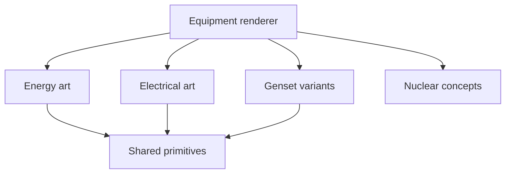

# Energy, electrical and nuclear artwork

[Symbol map](../README.md) · [Source map](../../README.md) · [Package map](../../../README.md) · [Power references](../../../docs/POWER_REFERENCES.md)

| Source | Owns |
| --- | --- |
| [energy.mjs](./energy.mjs) | Prime movers, thermal/hydro/solar/marine equipment and supplied transport layers. |
| [electrical.mjs](./electrical.mjs) | Converters, contacts, instrument transformers, relay and substation forms. |
| [generators.mjs](./generators.mjs) | Explicit genset technology/enclosure variants. |
| [nuclear.mjs](./nuclear.mjs) | Conceptual nuclear vessels, circuits, rods and monitoring. |
| [primitives.mjs](./primitives.mjs) | Shared original geometry, materials and detail helpers. |
| [power.css](./power.css) / [nuclear.css](./nuclear.css) | Scoped motion, state gates and static/reduced-motion presentations. |

Technology, circuit and fuel descriptors belong in [power metadata](../../catalog/definitions/power.mjs). The artwork receives state; it does not decide protection trips, solve electrical networks or simulate reactor dynamics. Keep source production, external circulation, retained heat and telemetry validity separate. A fault label does not imply a successful protective action.

[State coverage](../../../docs/STATE_COVERAGE.md) records verified distinctions and open design/model limitations. Nuclear drawings use fictional illustrative readings and original schematic geometry; reference notes do not make them validated safety or design models.

