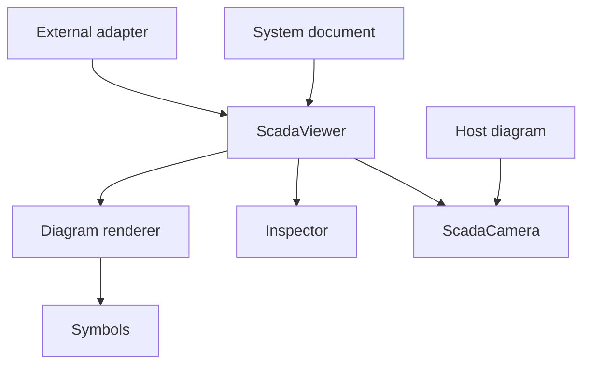
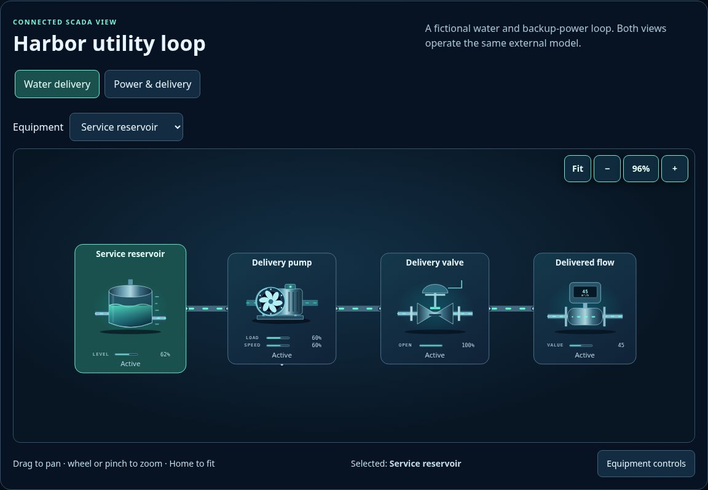

# Diagram view and controller

[Source map](../README.md) · [Package map](../../README.md) · [Viewer API](../../docs/API.md#viewer-api) · [Runnable example](../../examples/viewer/README.md)

`viewer.mjs` and `viewer.css` own diagram layout, selection, zoom, equipment inspection and command dispatch. `renderScadaDiagram` is presentation; `ScadaViewer` is the adapter-driven controller. The external adapter owns snapshots, subscriptions and optional command execution. Several views can share that adapter. Switching or destroying a view must never reset the external model, and rendering motion is separate from simulation time.

| Source | Ownership |
| --- | --- |
| [viewer.mjs](./viewer.mjs) | Pure diagram geometry renderer and adapter-driven selection, inspection and command controller. Public camera re-export. |
| [process-layout.mjs](./process-layout.mjs) | Pure, opt-in process-chain geometry projection. Retains identities and declared ports; complex authored diagrams are left intact. |
| [camera.mjs](./camera.mjs) | DOM-only 2D pan/zoom, fit, pointer/touch/keyboard navigation, screen-space recovery control and resize/lifecycle cleanup. No imports or model dependencies. |
| [viewer.css](./viewer.css) | Bounded viewport, diagram appearance and camera controls. Ordinary page and inspector scrolling remain available. |

The default `ScadaViewer` mounts a camera and preserves its transform across snapshot patches. Host attachment with `render:false` leaves camera ownership to the host. `ScadaCamera` also accepts a direct world element without renderer markup, so reference drawings and simulator layouts share interaction behavior without sharing a physical model. Keep camera state in presentation preferences; never use pan/zoom to mutate equipment or simulation state. See the [camera contract](../../docs/API.md#reusable-2d-camera) for methods and lifecycle guarantees.

The child dependencies have their own maps: [symbols](../symbols/README.md), [workspace](../workspace/README.md) and [system contracts](../contracts/README.md). The viewer accepts a validated document and adapter, not a URL to a plant or a hidden model constructor. Missing readings stay diagnosable; read-only adapters omit command dispatch.

