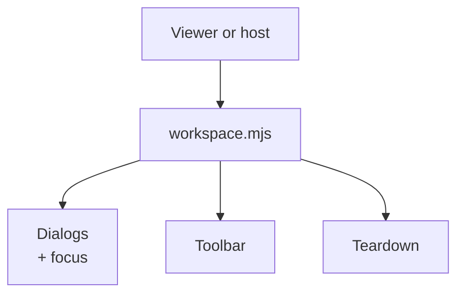
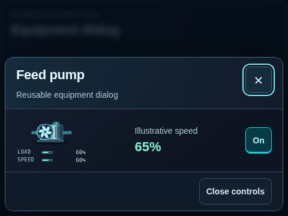

# Workspace interaction primitives

[Source map](../README.md) · [Package map](../../README.md) · [Lifecycle API](../../docs/API.md#workspace-api) · [Viewer owner](../viewer/README.md)

The host owns the external model and session; these primitives own presentation and listener lifecycle.

| Source | Responsibility |
| --- | --- |
| [workspace.mjs](./workspace.mjs) | Toolbar/dialog markup, native dialog behavior, focus return, keyboard handling and owned listener cleanup. |
| [workspace.css](./workspace.css) | Reusable workspace surfaces, buttons, panels, metrics and responsive presentation. |

The host supplies trusted body/footer/control markup and keeps untrusted text escaped. Workspace primitives do not interpret equipment physics, run a clock or persist the plant. Destroy a workspace before replacing/removing its root; preserve external session state. Keep native controls, visible focus and keyboard escape/focus-return behavior when extending a dialog.

Use [the viewer example](../../examples/viewer/README.md) to see the primitives inside an equipment inspector. The package-owned [workspace gallery](../../img/thumbnails/README.md) also shows toolbars, status bars, buttons, panels and metric strips. Shared CAD HUD extraction is an integration direction, not a separate shared-HUD API implemented here.

