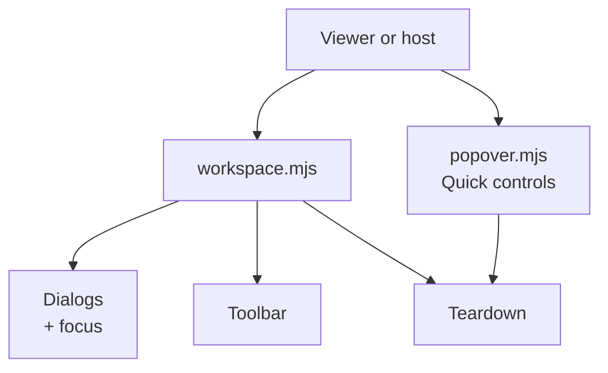
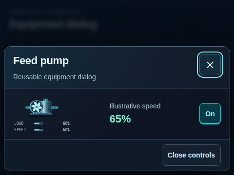

# Workspace interaction primitives

[Source map](../README.md) · [Package map](../../README.md) · [Lifecycle API](../../docs/API.md#workspace-api) · [Viewer owner](../viewer/README.md)

The host owns the external model and session; these primitives own presentation and listener lifecycle.

| Source | Responsibility |
| --- | --- |
| [workspace.mjs](./workspace.mjs) | Toolbar/dialog markup, native dialog behavior, focus return, keyboard handling and owned listener cleanup. |
| [workspace.css](./workspace.css) | Reusable workspace surfaces, buttons, panels, metrics and responsive presentation. |
| [popover.mjs](./popover.mjs) | Nonmodal anchored quick controls, viewport placement, dismissal and owned listener cleanup. |
| [popover.css](./popover.css) | Compact screen-space header, scrolling control body and optional footer. |

The host supplies trusted body/footer/control markup and keeps untrusted text escaped. Workspace primitives do not interpret equipment physics, run a clock or persist the plant. Destroy a workspace before replacing/removing its root; preserve external session state. Keep native controls, visible focus and keyboard escape/focus-return behavior when extending a dialog.

`ScadaPopover` owns a separate, nonmodal lifecycle for frequent equipment controls.
Pass a connected `[data-scada-popover]` section with a heading, an explicit
`[data-scada-popover-close]` button and `tabindex="-1"`. Its `open(panel,
{anchor, opener, focus})` method accepts an element or an anchor resolver, so the
host can retain the same equipment identity through diagram updates. Native
manual popovers use the browser top layer; the fixed-position fallback keeps the
same placement and focus behavior. The panel fits near the anchor and within the
visible viewport, with a default width of 360 px and maximum height of 440 px.

Use `.scada-popover-header`, `.scada-popover-heading`, `.scada-popover-body` and
`.scada-popover-footer` for the compact surface. Only the body scrolls. The host
calls `reposition()` after camera pan/zoom; the primitive also observes window,
visual-viewport, document-scroll and panel-size changes. It never traps focus,
blocks the diagram or locks page scrolling. Close and Escape normally return
focus to the opener; outside dismissal preserves the clicked destination.
`close({restoreFocus, reason})`, `activePanel` and `destroy()` expose the owned
lifecycle. `onClose({panel, reason})` lets the host update its disclosure state.

Live DOM patchers must preserve the open panel's `hidden`, `style`, `popover` and
`data-scada-popover-open` attributes. The fallback removes `popover` while open
and restores the original attribute when closed, retaining native field focus in
DOM implementations without the native methods. Close it before replacing its equipment
identity, and keep model commands and editable state outside this primitive.

Use [the viewer example](../../examples/viewer/README.md) to see the primitives inside an equipment inspector. The package-owned [workspace gallery](../../img/thumbnails/README.md) also shows toolbars, status bars, buttons, panels and metric strips. Shared CAD HUD extraction is an integration direction, not a separate shared-HUD API implemented here.

