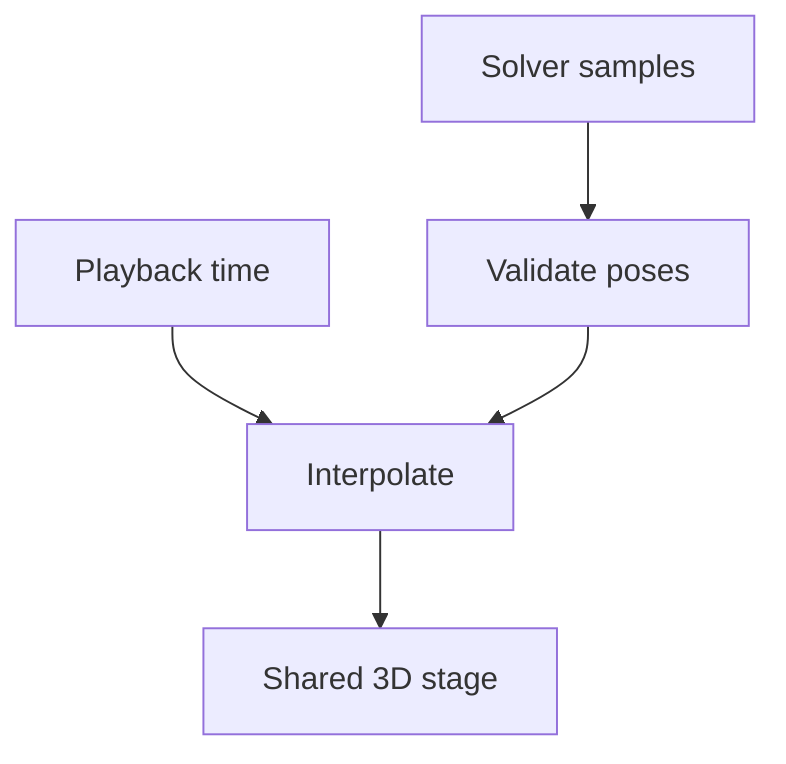

# Recorded simulation playback

Replay captured rigid-body poses through the shared 3D stage. The browser interpolates a completed solver run;
it does not recompute dynamics. The original two-link arm demonstrates the pipeline, not a qualified robot design.

| File | Responsibility |
| --- | --- |
| [viewer.js](viewer.js) | Reusable shared-host adapter, visible playback controls, theme and cleanup. |
| [scene.js](scene.js) | Local primitives and recorded world transforms on the metre-based shared stage. |
| [viewer.html](viewer.html) | Standalone original arm example with inspectable evidence. |
| [viewer.css](viewer.css) | Contained replay and responsive page layout. |
| [page.js](page.js) | Example receipt verification and page lifecycle. |
| [examples/](examples/README.md) | Portable recordings, generated models and solver receipts. |
| [replay.js](replay.js) | Bounded pose validation, interpolation, caller-owned playback clock and verified loading. |

The `cad-agent.pose-recording/1` format uses metres, a right-handed Z-up world and xyzw unit quaternions.
`bodies` defines unique IDs and local display primitives; every frame supplies complete poses in that body order.
Frames start at zero and have strictly increasing `time_s`. Box sizes are full XYZ dimensions; cylinders use
radius and full length along local Z; spheres use radius. Each primitive has its own local position and quaternion.

`validateRecording(value)` returns detached immutable data. `samplePose(recording, seconds)` clamps to the captured
window, linearly interpolates position and takes the shortest quaternion path. `createPlayback(recording, callback)`
exposes `play`, `pause`, `seek`, `setSpeed`, `advance`, `state` and idempotent `dispose`; the host owns its clock.
No source object is mutated and playback does not infer forces or enforce joints between samples.

Mount `createReplayViewer(container, {recordingUrl, expectedHash})` from `viewer.js` in a connected element with an
explicit height. Load `ui/theme.css`, `host/viewer-host.css` and `simulation/viewer.css`, and the toolkit's local
Three.js import map. Await `viewer.ready`; use `viewer.playback` for controls, `viewer.fit()` for the full motion,
and `viewer.dispose()` when removing it. The adapter uses the shared host and stage; it owns no global clock.
The scene root maps source `(x, y, z)` to stage `(x, z, -y)` in metres, including every geometry and rotation.

`loadRecording` verifies a supplied expected SHA-256. `loadReceipt` reads the bounded example receipt, and the
standalone page uses its artifact hash for the recording load. A different application can supply already parsed
data through `{recording}`. The full wheel and `cad-agent webkit` copy include this owner and its portable example;
frozen assembly readers keep their existing smaller runtime profile.

Limits are 16 MiB of downloaded JSON, 32 bodies, 30,001 frames, 200,000 total poses and one hour of captured time.
The decoder rejects malformed units, identifiers, timestamps, dimensions and nonfinite or nonunit poses.
An expected SHA-256 verifies the downloaded bytes, not the accuracy of the source model.

[Toolkit map](../README.md)
