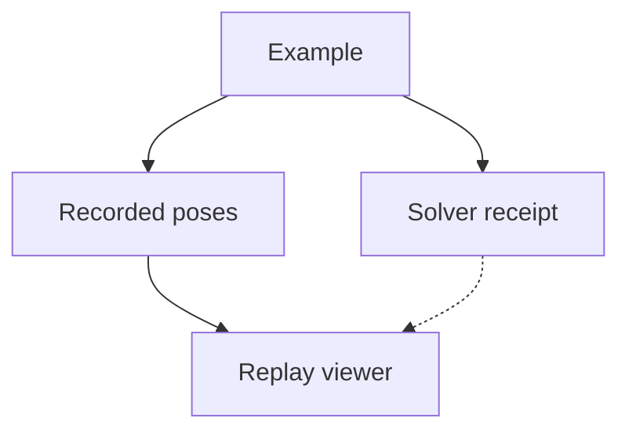

# Recorded examples

Each example bundles the data needed for browser playback and a solver receipt.

| Folder | Example |
| --- | --- |
| [two-link-arm/](two-link-arm/README.md) | Original articulated arm, illustrative masses and bounded joint torques. |

[Simulation map](../README.md)
