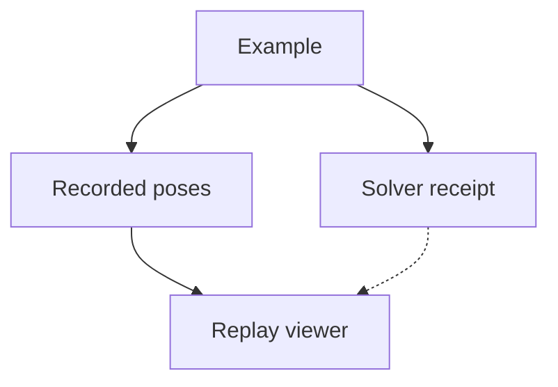

# Recorded examples

Each example bundles the data needed for browser playback and a receipt of where it came from.

| Folder | Example |
| --- | --- |
| [gyropup-v2/](gyropup-v2/README.md) | Gyropup, a wheel-legged robot: four recorded scenarios from its dated snapshot, with its own meshes and summaries. |
| [two-link-arm/](two-link-arm/README.md) | Original articulated arm, illustrative masses and bounded joint torques; the small editable example. |

[Simulation map](../README.md)
