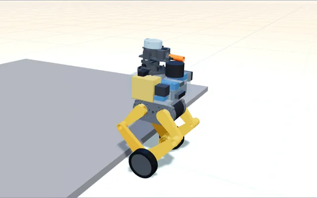
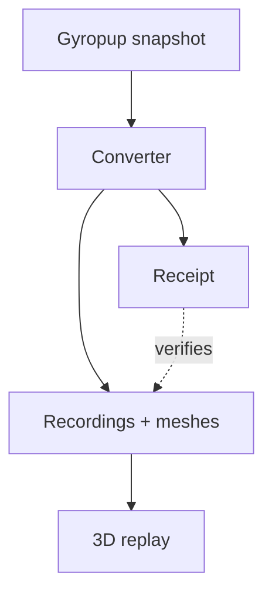

# Gyropup recorded scenarios

Gyropup, a wheel-legged robot, in four recorded MuJoCo runs from its own repository's dated snapshot: drive off a
kerb, ride one wheel along a plank, recover from pushes and land a drop. Open [the viewer](viewer.html), choose a
scenario, play, scrub and orbit. The poses are recorded solver output, replayed, not recomputed.

| File | Contents |
| --- | --- |
| [viewer.html](viewer.html) | The example page: a scenario select, the snapshot's own verdict and peak motor torque, and playback. |
| [index.json](index.json) | The scenarios, each recording's SHA-256 and the snapshot's summary for it, and the mesh library's hash. |
| [kerb_drop.json](kerb_drop.json), [side_kerb.json](side_kerb.json), [push.json](push.json), [landing.json](landing.json) | Recorded body poses (one every 33 ms of solver time), fixed scenery such as the kerb, and the camera's followed body. |
| [robot.json](robot.json), [robot.bin](robot.bin) | Gyropup's rig meshes, each in its own body's frame, packed by `pack_view`. |
| [receipt.json](receipt.json) | Gyropup revision, every source file's SHA-256, the converter's hash, the method and the limits. |
| [LICENSE.txt](LICENSE.txt) | Gyropup's MIT licence, which these meshes and recordings carry. |
| [card.webp](card.webp), [card-still.webp](card-still.webp), [card.json](card.json) | The toolkit and home cards' animation and still, and their capture record. |

The [converter and capture scripts](https://github.com/Valpatel/cad-agent/tree/main/docs/examples/robot-replay)
live in the source repository; they need a Gyropup checkout, not MuJoCo.

Gyropup is a work-in-progress prototype. Its README calls this snapshot (generated 2026-10-25 to 26, captured
2026-10-28) a historical demo, not a validation of the latest CAD or of physical hardware. Pass verdicts and torques
are the snapshot's own numbers, not a cad-agent verification. Interpolated poses do not enforce contacts or joint
constraints between frames, and CAD and simulation do not prove physical fit, strength or control safety.

[Examples map](../README.md)
