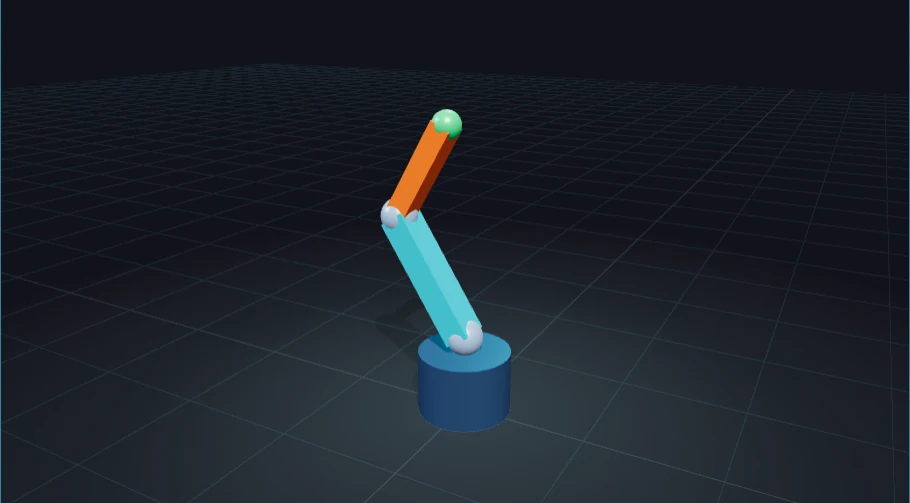
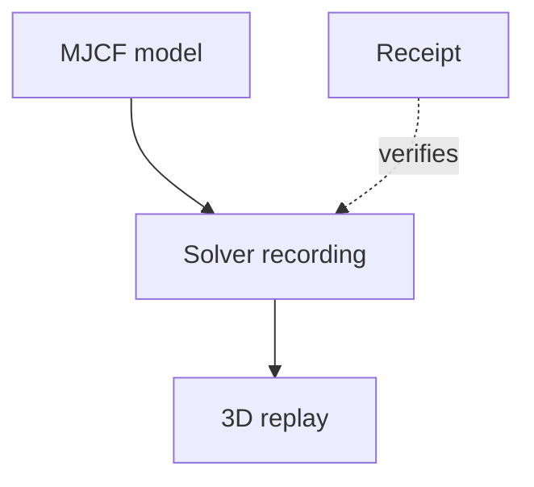

# Two-link arm recording

This is an actual offline MuJoCo run of an original illustrative arm. Play, pause and scrub the recorded poses in
[the viewer](../../viewer.html). Controls change presentation; they do not run physics in the browser.

| File | Contents |
| --- | --- |
| [model.xml](model.xml) | Generated SI model, inertias, joints, torque motors and solver settings. |
| [recording.json](recording.json) | Complete timestamped body poses with local display primitives. |
| [receipt.json](receipt.json) | Engine/settings, source/artifact hashes, observations and editable input snapshot. |
| [preview.webp](preview.webp) | Real browser thumbnail, paused at 3.2 seconds. |
| [preview.json](preview.json) | Thumbnail browser, source and image identity. |

The canonical [producer and editable configuration](https://github.com/Valpatel/cad-agent/tree/main/docs/examples/robot-replay)
live in the same repository. A full source clone carries them; the copied browser kit carries the portable recording.
The receipt includes the configuration snapshot for inspection. Changing physics requires a new producer run.

Masses, dimensions and controller gains are examples, not measurements. Rigid uniform-box links and ideal torque
motors omit flexibility, backlash, electrical/thermal limits and payload qualification. Playback interpolates poses
and does not establish physical fit, strength, safe operation or Gyropup performance.

[Examples map](../README.md)
