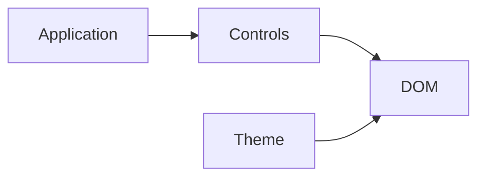

# Shared browser controls

Reusable HUD, panel controls, navigation and gallery filtering. These elements do not own document models or simulation clocks.

| File | Responsibility |
| --- | --- |
| [theme.css](theme.css), [theme.js](theme.js) | Shared light/dark application palette, local fonts, system default and persisted theme controls; no website dependency. |
| [hud.css](hud.css) | Fullscreen HUD skin and standard control presentation. |
| [panel.js](panel.js) | DOM helpers for sections, sliders, toggles, readouts and panel insets. |
| [appnav.js](appnav.js) | Application navigation composed into standalone views. |
| [gallery.js](gallery.js) | Reusable searchable/filterable gallery cards and state. |
| [gallery.css](gallery.css) | Gallery layout and interaction styling. |

## Application themes

Load `theme.js` as a classic script in the document head before stylesheets, and
load `theme.css` for the application palette. The script applies an existing
`cad-theme` localStorage choice before first paint; absent a choice, CSS follows
`prefers-color-scheme`. A button with `class="theme-toggle"`, `aria-pressed="false"`
and `hidden` becomes available when its click behavior is ready. The hidden
button reserves its box, preventing layout movement during startup.

The controller toggles `data-theme` on the document root and emits
`cad-themechange` with `detail.theme`. Only changes to the effective mode emit an event, including system changes when
there is no explicit choice and preferences changed in another tab. Hosts own any
renderer-specific refresh. A choice matching the system is cleared so later system changes apply. Storage
failure does not prevent local controls from working; no network request is made.
These opt-in application tokens do not replace process-state colors or a
renderer’s scoped palette.

The public website and the standalone SCADA Explorer consume these same files.
A copied kit keeps the relative `vendor/fonts/` dependency and its font notices.

[Web kit](../README.md)
