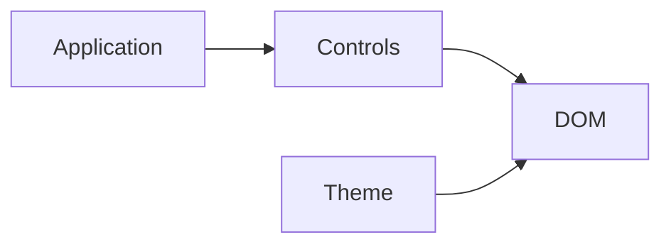

# Shared browser controls

Reusable HUD, panel controls, navigation and gallery filtering. These elements do not own document models or simulation clocks.

| File | Responsibility |
| --- | --- |
| [hud.css](hud.css) | Fullscreen HUD skin and standard control presentation. |
| [panel.js](panel.js) | DOM helpers for sections, sliders, toggles, readouts and panel insets. |
| [appnav.js](appnav.js) | Application navigation composed into standalone views. |
| [gallery.js](gallery.js) | Reusable searchable/filterable gallery cards and state. |
| [gallery.css](gallery.css) | Gallery layout and interaction styling. |

[Web kit](../README.md)
