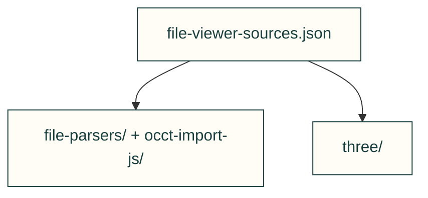
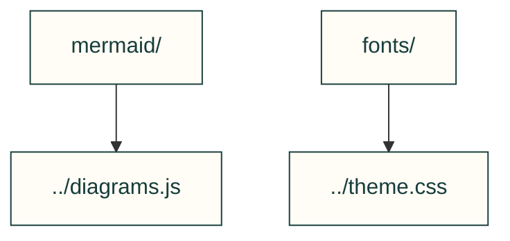

# Browser component sources

Owned provenance records surround pinned upstream bytes. Integrity and parser limits remain in the source records and existing component tests.

Recorded file-viewer dependencies

Diagram and theme dependencies

| File or folder | Purpose |
|---|---|
| [FILE-VIEWER-NOTICES.md](FILE-VIEWER-NOTICES.md) | Parser/renderer licence and source disclosures. |
| [file-viewer-sources.json](file-viewer-sources.json) | Exact parser component pins, source URLs and hashes. |
| [file-parsers/](https://github.com/Valpatel/cad-agent/tree/dev/software/cadagent/webkit/vendor/file-parsers) | Pinned mesh decoders. |
| [fonts/](https://github.com/Valpatel/cad-agent/tree/dev/software/cadagent/webkit/vendor/fonts) | Pinned fonts, licences and owned CSS wrapper. |
| [linkedom/](https://github.com/Valpatel/cad-agent/tree/dev/software/cadagent/webkit/vendor/linkedom) | Pinned DOM helper used for server rendering. |
| [mermaid/](https://github.com/Valpatel/cad-agent/tree/dev/software/cadagent/webkit/vendor/mermaid) | Reproducible derived diagram renderer and build/input records. |
| [occt-import-js/](https://github.com/Valpatel/cad-agent/tree/dev/software/cadagent/webkit/vendor/occt-import-js) | Pinned STEP parser runtime and matching LGPL source. |
| [three/](https://github.com/Valpatel/cad-agent/tree/dev/software/cadagent/webkit/vendor/three) | Pinned browser renderer and selected add-ons. |

[Parent map](../README.md)
