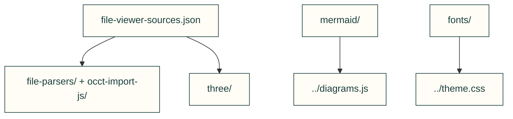

# Browser component sources

Owned provenance records surround pinned upstream bytes. Integrity and parser limits remain in the source records and existing component tests.

| File or folder | Purpose |
|---|---|
| [FILE-VIEWER-NOTICES.md](FILE-VIEWER-NOTICES.md) | Parser/renderer licence and source disclosures. |
| [file-viewer-sources.json](file-viewer-sources.json) | Exact parser component pins, source URLs and hashes. |
| [file-parsers/](file-parsers/) | Pinned mesh decoders. |
| [fonts/](fonts/) | Pinned fonts, licences and owned CSS wrapper. |
| [linkedom/](linkedom/) | Pinned DOM helper used for server rendering. |
| [mermaid/](mermaid/) | Reproducible derived diagram renderer and build/input records. |
| [occt-import-js/](occt-import-js/) | Pinned STEP parser runtime and matching LGPL source. |
| [three/](three/) | Pinned browser renderer and selected add-ons. |

[Parent map](../README.md)
