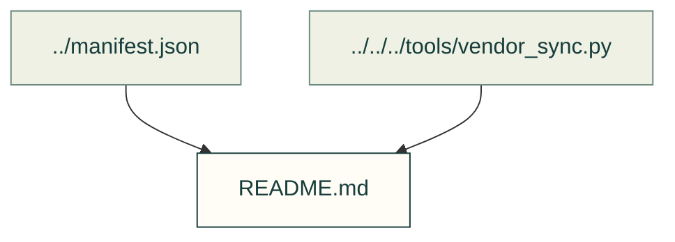

# Reviewed scan baselines

Accepted scan fingerprints for the exact imported project revisions.

Files and sources

| File or folder | Purpose |
|---|---|
| [agentcad.json](agentcad.json) | Reviewed fingerprint for agentcad. |
| [bd_warehouse.json](bd_warehouse.json) | Reviewed fingerprint for bd_warehouse. |
| [build123d-mcp.json](build123d-mcp.json) | Reviewed fingerprint for build123d-mcp. |
| [kicad-happy.json](kicad-happy.json) | Reviewed fingerprint for kicad-happy. |
| [kicad-mcp-pro.json](kicad-mcp-pro.json) | Reviewed fingerprint for kicad-mcp-pro. |
| [text-to-cad.json](text-to-cad.json) | Reviewed fingerprint for text-to-cad. |

[Vendor index](../README.md) · [Import/accept producer](../../../tools/vendor_sync.py) · [Audit consumer](../../../tools/resource_audit.py). Existing receipts are preserved; adding this map does not accept new findings.
