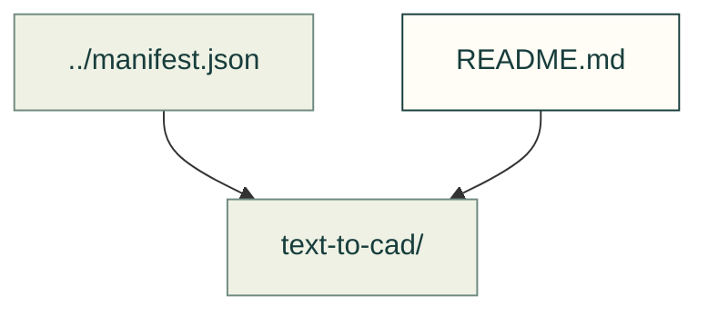

# Local upstream patches

Changes applied after importing a pinned upstream revision. Keep the patch and its upstream provenance together.

Files and sources

| File or folder | Purpose |
|---|---|
| [text-to-cad/](text-to-cad/README.md) | The retained local patch for the imported text-to-cad tool. |

[Vendor index](../README.md) · [Patch application](../../../tools/vendor_sync.py)
