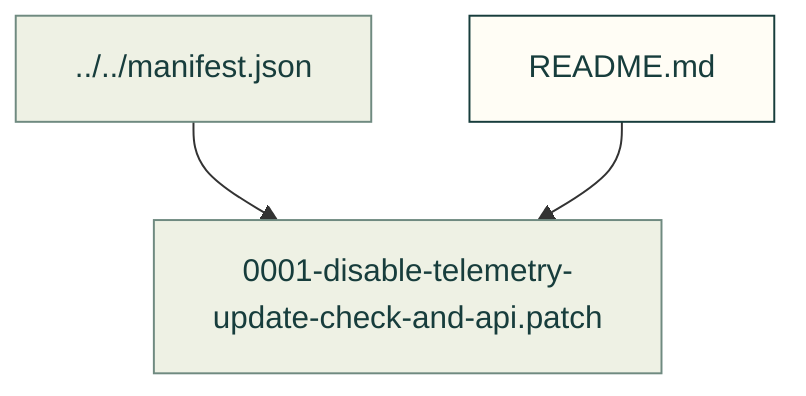

# Text-to-CAD patch

The existing patch disables telemetry, update checking and API access in the imported tool. Read its diff and the pinned manifest before applying it elsewhere.

Files and sources

| File or folder | Purpose |
|---|---|
| [0001-disable-telemetry-update-check-and-api.patch](0001-disable-telemetry-update-check-and-api.patch) | Existing local change applied by the vendor import tool. |

[Patch index](../README.md) · [Pinned imports](../../manifest.json)
