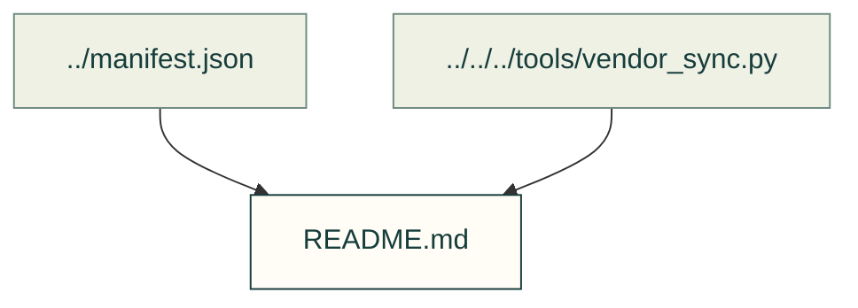

# Import scan reports

Dated findings retained from the vendor import process. A report is not a current security clearance.

Files and sources

| File or folder | Purpose |
|---|---|
| [agentcad-52af472dda.md](agentcad-52af472dda.md) | Dated scan report; the filename identifies the project and revision. |
| [bd_warehouse-e6ae6e7bae.md](bd_warehouse-e6ae6e7bae.md) | Dated scan report; the filename identifies the project and revision. |
| [build123d-mcp-59b2561218.md](build123d-mcp-59b2561218.md) | Dated scan report; the filename identifies the project and revision. |
| [kicad-happy-2fd9aa0fe2.md](kicad-happy-2fd9aa0fe2.md) | Dated scan report; the filename identifies the project and revision. |
| [kicad-mcp-pro-f03b478f59.md](kicad-mcp-pro-f03b478f59.md) | Dated scan report; the filename identifies the project and revision. |
| [text-to-cad-2f793659fb.md](text-to-cad-2f793659fb.md) | Dated scan report; the filename identifies the project and revision. |

[Vendor index](../README.md) · [Import/accept producer](../../../tools/vendor_sync.py) · [Audit consumer](../../../tools/resource_audit.py). Existing receipts are preserved; adding this map does not accept new findings.
