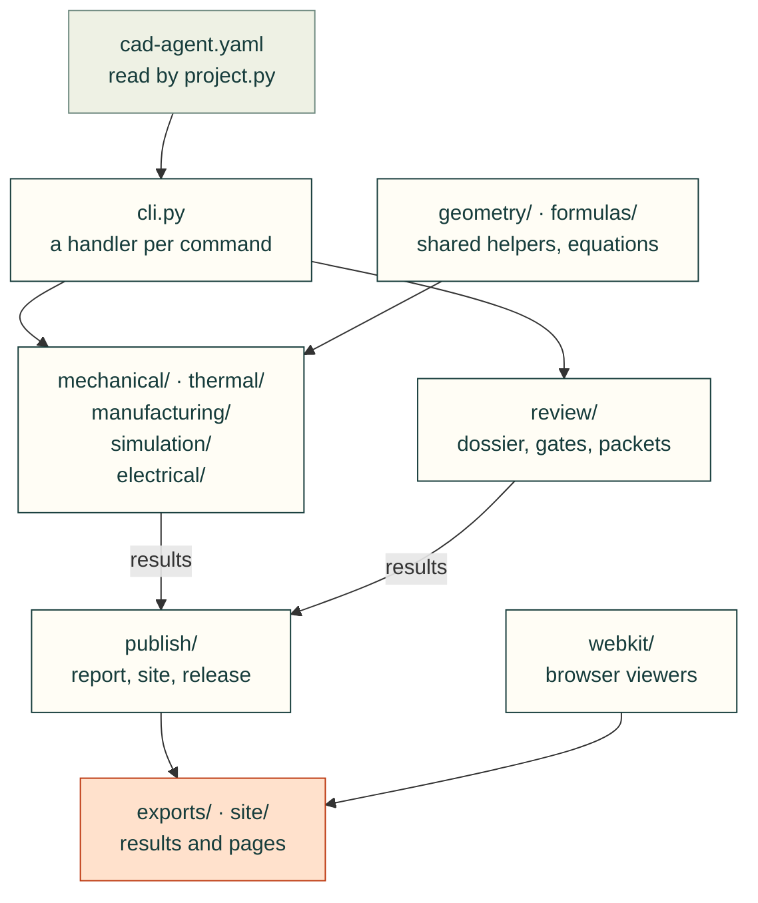

# cadagent

The Python package behind the `cad-agent` command: it builds a CAD project, checks it, simulates it, makes the files
to print and order, and publishes what it found. Its packages mirror the domains of the
[topic tree](../../docs/areas.yaml), so the code for a topic is where the map puts it.

`cli.py` imports every package, and `mechanical/` and `publish/` import the shared helpers in `geometry/` (a project's
build script uses them most). `formulas/` holds the closed-form equations any domain can call. `publish/` reads what the domain packages' checks and `review/` wrote (simulation results
arrive as check outputs, and `simulation/` also writes its own pages). The site build copies the kit's diagram
renderer from `webkit/`.

## What's here

| Package or module | What it is for (its place in docs/areas.yaml) |
|---|---|
| [`geometry/`](geometry/README.md) | Shared CAD helpers: solids, print STLs, reproducible STEP, gaps, downward area, bed fit |
| [`formulas/`](formulas/README.md) | Closed-form engineering equations with units, limits and sources: beams, snap arms, torsion, springs, screws, four-bars, heat flow and fans (shared core) |
| [`mechanical/`](mechanical/README.md) | Holes, fasteners, McMaster-Carr parts, connector windows, markings, compliant features, motion traces (mechanical) |
| [`manufacturing/`](manufacturing/README.md) | 3MF print files and slicer numbers (manufacturing) |
| [`thermal/`](thermal/README.md) | Plate-fin heat sinks and fan operating points (thermal) |
| [`simulation/`](simulation/README.md) | FEA, CFD, topology optimisation, robot export, design exploration, and their pictures and reports (simulation) |
| [`electrical/`](electrical/README.md) | PCB evidence and routed-board measurements (electrical) |
| [`review/`](review/README.md) | The design dossier, integrity gates, review packets, evidence hashes, the review workbench (practice: design process, review and evidence) |
| [`publish/`](publish/README.md) | Results JSON, HTML reports, renders, 3D views, the project site, the local server, the print release (practice: publishing) |
| [`webkit/`](webkit/README.md) | Browser pieces: 3D stage, file and FEA viewers, part tables, diagrams, copy buttons |
| `cli.py` | `cad-agent <subcommand>`: the parser and the handlers |
| `project.py` | The `cad:` section of a project's `cad-agent.yaml` |
| `links.py`, `package.py` | Local link checks, the review zip |
| `agentkit.py` | `cad-agent agents install`: the skills and subagents for Claude Code and Codex |
| `_deps.py`, `_moved.py` | Lazy optional dependencies; old module paths (`cadagent.fea` → `cadagent.simulation.fea`) until v0.7.0 |

New modules go into the package for their domain in [docs/areas.yaml](../../docs/areas.yaml), with a line in that
domain's `api:` list. `tests/test_package_layout.py` keeps this top level short, and `tests/test_package_areas.py`
keeps the packages and the tree in step.

## Related

[Repository README](../../README.md) · [Toolkit reference](../../docs/toolkit.md) · [Tests](../../tests) ·
[Style guide](../../docs/style-guide.md) · [Topic tree](../../docs/areas.yaml)
