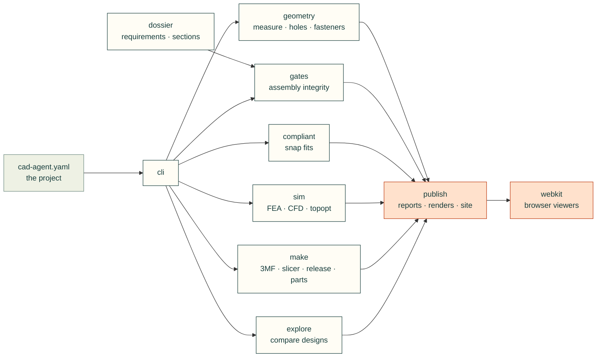

# cadagent

The Python package behind the `cad-agent` command: it builds a CAD project, checks it, simulates it, makes the files
to print and order, and publishes what it found.

## What's here

| Package or module | What it is for |
|---|---|
| [`geometry/`](geometry/README.md) | Measuring and checking part geometry: bounds, sections, clearances, holes, fasteners, connectors, markings |
| [`gates/`](gates/__init__.py) | Assembly integrity gates (access order, containment, fasteners, motion, walls), each written as a verdict |
| [`compliant/`](compliant/__init__.py) | Compliant features that replace parts: snap fits now, hinges and flexures next |
| [`sim/`](sim/README.md) | FEA, CFD, heat sinks, topology optimisation, robot export, motion traces, and their pictures and reports |
| [`make/`](make/README.md) | 3MF files, slicing, print releases, McMaster-Carr parts, PCB evidence |
| [`publish/`](publish/README.md) | Results JSON, HTML reports, renders, 3D views, review packets and pages, the project site, the local server |
| [`dossier/`](dossier/__init__.py) | The design dossier: requirements, sections, spec cards, interfaces, decisions |
| [`explore/`](explore/__init__.py) | Pick parts from catalogues, evaluate designs, rank the trade-offs |
| [`webkit/`](webkit/README.md) | Browser pieces: 3D stage, file and FEA viewers, part tables, diagrams, copy buttons |
| `cli.py` | `cad-agent <subcommand>`: the parser and the handlers |
| `project.py` | The `cad:` section of a project's `cad-agent.yaml` |
| `evidence.py`, `links.py`, `package.py` | Shared record screening, local link checks, the review zip |
| `agentkit.py` | `cad-agent agents install`: the skills and subagents for Claude Code and Codex |
| `_deps.py`, `_moved.py` | Lazy optional dependencies; old module paths (`cadagent.fea` → `cadagent.sim.fea`) until v0.7.0 |

New modules go into the package for their job; `tests/test_package_layout.py` keeps this top level short.

## Related

[Repository README](../../README.md) · [Toolkit reference](../../docs/toolkit.md) · [Tests](../../tests) ·
[Style guide](../../docs/style-guide.md)
