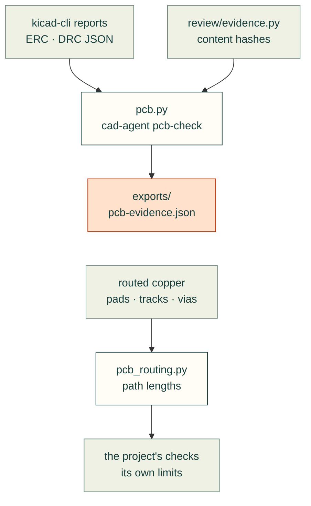

# cadagent.electrical

The electrical domain of the [topic tree](../../../docs/areas.yaml): evidence that a circuit board is ready to order,
and measurements of a routed board. CAD validity and production qualification stay separate.

Arrows follow the data. `pcb.py` imports `review/evidence.py`'s `hashes_are_current` to tell a current report from a
stale one; `pcb_routing.py` imports nothing from cad-agent and needs no KiCad.

| Module | What it does |
|---|---|
| `pcb.py` | PCB evidence adapters (`cad-agent pcb-check`); CAD validity and production qualification stay separate |
| `pcb_routing.py` | Geometry-only path measurements for routed boards, without KiCad |

Related: [package map](../README.md) · [PCB docs](../../../docs/pcb.md) · [review](../review/README.md) (evidence
hashes)
