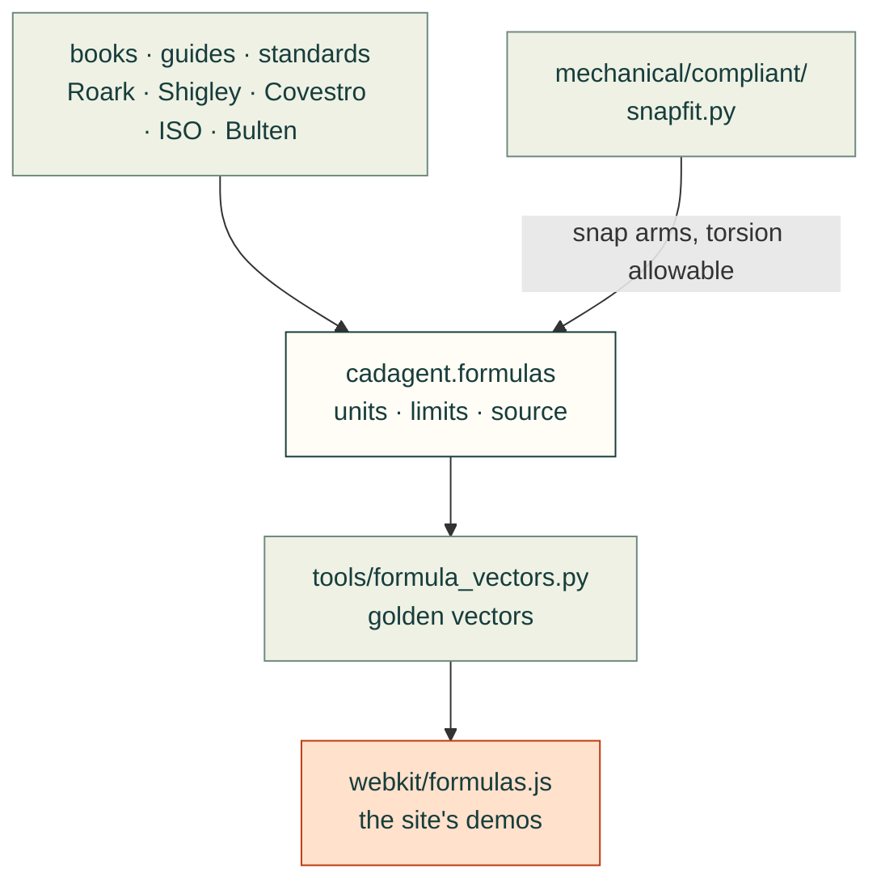

# cadagent.formulas

Closed-form engineering equations that every domain keeps needing. Each one gives its SI units, the limits where it
stops being valid, and its source by author, title, edition and section:
- beams and snap arms;
- torsion bars;
- coil springs;
- screw preload and thread strip;
- four-bar linkages;
- conduction, film resistance, fans in series and parallel, fan operating points and the stall region.

`from cadagent import formulas as fx`, then `fx.catalogue()` lists every formula. It sits in the shared core, beside
`geometry/`, because its users span mechanical and thermal design. See [docs/formulas.md](../../../docs/formulas.md).

Arrows follow the data and the imports:
- the books and standards give the equations, never copied text;
- `beams.py` calls `mechanical/compliant/snapfit.py`, so a snap arm here matches `cad-agent snapfit` exactly, and
  `torsion.py` takes its allowable shear strain from there too;
- `tools/formula_vectors.py` writes golden vectors from this Python, and the browser port in `webkit/formulas.js` is
  tested against them (`--check` keeps the two in step).

| Module | What it computes |
|---|---|
| `_registry.py` | The registry: every public function's units, limits and source; `catalogue()` lists them |
| `beams.py` | Second moment, cantilever deflection and shape, strain profile, tapered arms, snap-arm strain and force |
| `torsion.py` | Torsion constants and shear stress of round and rectangular bars, torsion-bar twist and stiffness, the peak shear strain of a twisted rectangle and a torsion-bar snap against the Covestro allowable |
| `springs.py` | Coil-spring index, Bergsträsser factor, rate and shear stress |
| `screws.py` | Tensile stress area, nut factor (any flank angle), preload from torque and back, thread shear areas and strip force, the thread's radial push and the boss's hoop stress, and a thread-forming screw in a plastic boss against Covestro's torque window |
| `linkages.py` | Grashof class and inversion, four-bar angles from the input angle, transmission angle, the input's limits |
| `thermal.py` | Wall and film resistance, wall heat flow, straight-line fan curve, system coefficient, fans in series and parallel, fan operating point, stall flow |

A closed form is not proof of fit or strength. Each result holds only within the limits it states, and a printed part
is weaker across its layers than any isotropic formula assumes. Test the part.

Related: [package map](../README.md) · [compliant features](../mechanical/README.md) ·
[formulas reference](../../../docs/formulas.md)
