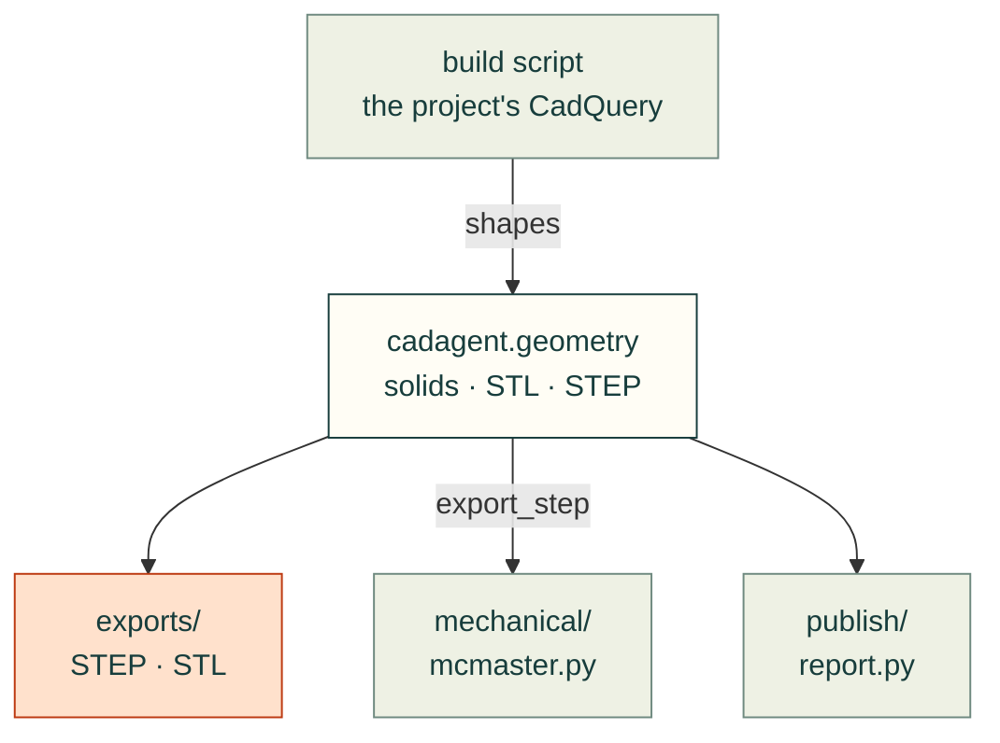

# cadagent.geometry

The shared CAD helpers every domain uses: `from cadagent.geometry import ...` measures and exports part geometry (solid
validity and bounds, print STLs, reproducible STEP files of parts and assemblies, intersections and gaps, downward area, bed fit), and `cadagent.geometry.cache` keeps built parts as BREP so a build rebuilds only what changed. Checks of
particular features live in their domain's package: holes, fasteners, connectors and markings in
[`mechanical/`](../mechanical/README.md).

Arrows follow the data and the imports. A project's build script passes its shapes in and gets files out;
`mechanical/mcmaster.py` imports `export_step` to write each bought part's normalised STEP, and `publish/report.py`
imports `within_bed`.

| Module | What it does |
|---|---|
| `__init__.py` | Solid reports, print STLs, `export_step` (the same STEP bytes on every build, #91), intersections and gaps, downward area, bed fit; CadQuery, OCP and trimesh are imported lazily |
| `cache.py` | `PartCache` (#250): built parts stored as BREP under a hash of their sources, parameters and per-part dependencies, checked (sha256, validity, volume) on load and rebuilt when damaged |
| `_assembly_step.py` | `export_step` for a cadquery `Assembly` (#150): the XCAF writer, with uuid node names replaced and the colour records put in one order |

Related: [package map](../README.md) · [mechanical checks](../mechanical/README.md) ·
[toolkit reference](../../../docs/toolkit.md#the-project-contract)
