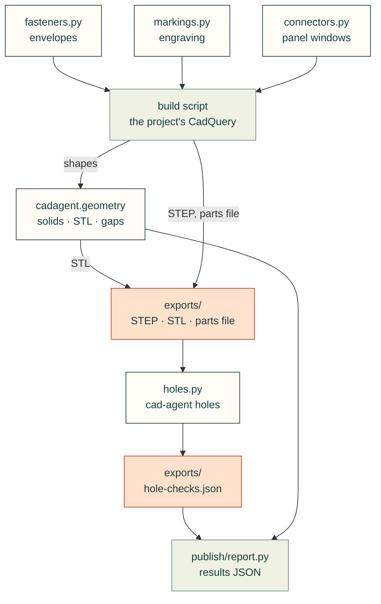

# cadagent.geometry

Measuring and checking part geometry. `from cadagent.geometry import ...` is the measuring API (solid validity and
bounds, print STLs, intersections and gaps, downward area, bed fit); the submodules check specific features.

Arrows follow the data. The three helpers at the top are imported by a project's build script, not by cad-agent;
`holes.py` reads the exported STEP files and part list, and `publish/report.py` imports `holes.py` and `within_bed` from
the API.

| Module | What it does |
|---|---|
| `__init__.py` | Shared geometry checks (CadQuery, OCP, trimesh; all imported lazily) |
| `holes.py` | Every hole in a part is empty of material (`cad-agent holes`); countersinks and drill points are probed as cones |
| `fasteners.py` | Dimension-driven fastener envelopes and axial stack checks |
| `connectors.py` | Mating-connector envelopes: panel windows from the plug, then proof that the plug fits |
| `markings.py` | One XY drawing for engraved markings and a matching SVG proof |

Related: [package map](../README.md) · [gates](../gates/__init__.py) (assembly-level checks) ·
[common issues](../../../docs/common-issues.md) (the mistakes these catch)
