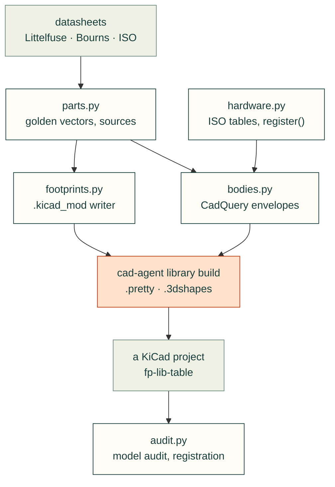

# cadagent.library

The parts library: KiCad footprints and 3D bodies for real parts, drawn from their datasheets; the hardware tables
the bodies are built from; and the checks that a board shows every part. It sits in the shared core, beside
`geometry/` and `formulas/`, because boards and mechanical assemblies both use it (#287). Its place in the topic tree is
electrical/circuit-boards/parts-library.

**Generators, not files.** cad-agent keeps no footprint or STEP files. `cad-agent library build OUT` writes a library a
KiCad project points its `fp-lib-table` at:

    OUT/cad-agent.pretty/<footprint>.kicad_mod      each with its model path (${KIPRJMOD}/...)
    OUT/cad-agent.3dshapes/<model>.step             coloured, reproducible STEP (needs the cad extra)

`--project DIR` makes the model paths relative to the KiCad project (`${KIPRJMOD}/<path to OUT>`). The project may
commit what was built.

**What it adopts, and the licences** (the survey is on #287):
- KiCad's stock libraries for the parts they have (0603, 2512, TSSOP-10, JST GH), used by name and
  `${KICAD10_3DMODEL_DIR}`, never copied. Copying them would bring in CC-BY-SA 4.0 and its own LICENSE file.
- The conventions of KiCad's generators (`kicad-library-tools`), but not their GPL code: millimetres, the origin at the
  footprint's, z = 0 on the board's top face, and y up in the 3D frame.
- The ISO head tables of the vendored `bd_warehouse` (Apache-2.0), checked row by row.
- Vendor and aggregator CAD (SnapEDA, Ultra Librarian, SamacSys, EasyEDA) is **never committed**. A project may fetch
  it for its own use and cite it, as the `mcmaster-parts` skill does for McMaster models.

Everything here is drawn from datasheet numbers, so it is MIT like the rest of cad-agent.

Arrows follow the data:

| Module | What it does |
|---|---|
| `parts.py` | The parts: footprint, body, the datasheet's numbers with the page each comes from, source and licence; `build()` |
| `footprints.py` | Footprints as data and the `.kicad_mod` writer (KiCad 9 format, stable UUIDs, no pcbnew); the parametric generators |
| `bodies.py` | CadQuery bodies in KiCad's model frame, their children named for the pads they meet (`pin<n>`, `terminal<n>`, `peg`); coloured STEP |
| `hardware.py` | Socket and button heads (ISO 4762, 7380-1), nyloc nuts and ring lugs by size, each with its source; `register()` for other families (#283's clinch hardware) |
| `audit.py` | `model_audit`: every footprint of a board or library has a model that resolves, or a waiver with its reason. `registration`: a body sits on the board, its pins pass through their pads' holes and its terminals lie over their pads |
| `sexp.py` | Reads and writes KiCad's S-expression files (standard library only) |

**The parts so far** are the ones Gyropup's fuse board needed first:
- the Littelfuse MINI FL1 holder 178.6764.0001, with MINI blade fuses by rating;
- the Bourns CSS2H-3920 shunt on a Kelvin layout;
- M4 and M6 lug studs;
- an M5 bonding mounting hole;
- a non-plated slot.

**Adding a part:**
1. Write its footprint generator and its body.
2. Add a `Part` with the datasheet's numbers and the page each comes from.
3. Add a test that holds the footprint and body to those numbers. `tests/library/test_bodies.py` already runs the
   registration check on every part with a body.

**Limits:**
- The bodies are envelopes: right for pictures, layout and clearance, but not the manufacturer's model.
- An assumed dimension is marked where it is used.
- The audit checks what the files say, not that the part matches its datasheet. A footprint that matches its datasheet
  can still be the wrong footprint for the part fitted, so check the part number.
- CAD does not prove fit, solderability or current rating.

**When it grows:**
- Split it into `kicad/` and `mechanical/` when either side reaches three modules of its own, for example when #283
  brings PEM and rivet bodies.
- Move it to its own repository only on a trigger: clones grow by tens of MB, the licences diverge (KiCad content
  adopted), or people want the parts without the toolkit.

Related: [package map](../README.md) · [electrical](../electrical/README.md) (board evidence) ·
[mechanical](../mechanical/README.md) (`mcmaster`, fastener envelopes) · [tests](../../../tests/library/README.md)
