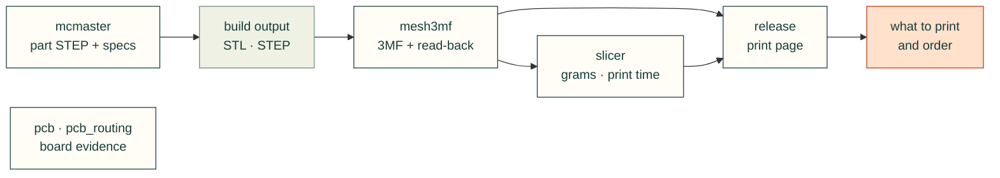

# cadagent.make

Getting from a checked model to real parts: print files, slicer numbers, a print release, bought hardware, and board
evidence.

| Module | What it does |
|---|---|
| `mesh3mf.py` | A minimal 3MF writer with an independent read-back check |
| `slicer.py` | Real filament grams and print time from Bambu Studio's command line, run as a separate program |
| `release.py` | The print release: a browsable page of printed parts with their CAD files and the source that builds them |
| `mcmaster.py` | McMaster-Carr parts: the manufacturer's STEP and product data for a part number, in a known frame |
| `pcb.py` | PCB evidence adapters; CAD validity and production qualification stay separate |
| `pcb_routing.py` | Geometry-only path measurements for routed boards, without KiCad |

Related: [package map](../README.md) · [mcmaster-parts skill](../../../skills/mcmaster-parts/SKILL.md) ·
[PCB docs](../../../docs/pcb.md)
