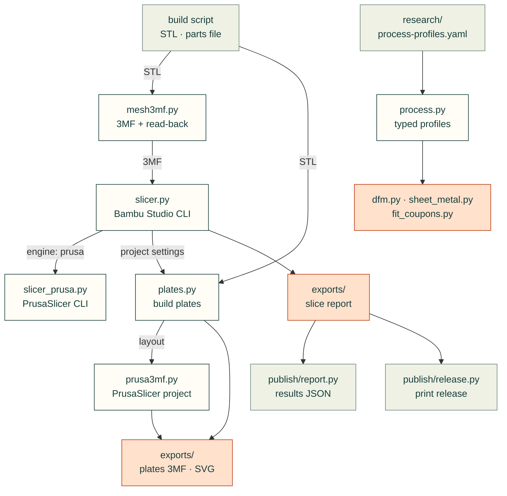

# cadagent.manufacturing

The manufacturing domain of the [topic tree](../../../docs/areas.yaml): getting from a checked model to print files and
real slicer numbers, and the process profiles that say what each process can make.

Arrows follow the files. `slicer.py` imports `publish/report.py`'s `load_parts` to find the parts it slices, and
`publish/report.py` and `publish/release.py` import `slicer.py` to read a current slice report; `slicer_prusa.py` runs
PrusaSlicer for `slicer.py` when `cad.slicer.engine` is `prusa`. `mesh3mf.py` imports
nothing from cad-agent. `plates.py` uses `mesh3mf.py`'s 3MF parts, asks `slicer.py` for Bambu Studio's project
settings, and reads the release's parts and quantities from `publish/release.py`. `prusa3mf.py` uses `mesh3mf.py`'s
3MF parts and `plates.py`'s layout for PrusaSlicer projects. `process.py` loads the cited rules of
`research/process-profiles.yaml` and the filaments' data sheets from `mechanical/compliant/allowables.py`; `dfm.py`,
`sheet_metal.py` and `fit_coupons.py` read their numbers from it.

| Module | What it does |
|---|---|
| `mesh3mf.py` | A minimal 3MF writer with an independent read-back check (`cad-agent export-3mf`) |
| `slicer.py` | Real filament grams and print time from Bambu Studio's command line, run as a separate program (`cad-agent slice`) |
| `slicer_prusa.py` | The same from PrusaSlicer's command line (`cad.slicer.engine: prusa`): vendor-bundle and user presets, grams and time from the G-code, and the warnings, errors and print stability issues from its log |
| `fit_coupons.py` | A printable coupon per fit (pin, bushing, bearing, insert), holes swept round nominal + allowance + the process profile's undersize, with a measurement sheet: the first print calibrates the fits ([printed joints](../../../docs/printed-joints.md#fit-coupons-let-the-first-print-calibrate-the-fits)) |
| `process.py` | The process profiles as typed values: rules, limits, tolerances, FDM layer factors by filament, a shop's bend table; each value with its rule id and source id, unverified rows marked `(u)` ([process checks](../../../docs/process-checks.md)) |
| `dfm.py` | Minimum features (walls, holes, pins, gaps, bridges, overhangs, flanges, hole-to-bend) against every cited source, and which way a printed feature's stress crosses the layers |
| `sheet_metal.py` | Bend allowance, deduction, flat length, K-factor, shortest flange and relief, from the shop's table first, then the generic rules |
| `plates.py` | Every printed part at its quantity packed onto build plates (MaxRects), in one Bambu Studio project 3MF with a read-back check and a top-down picture (`cad-agent export-3mf`) |
| `prusa3mf.py` | PrusaSlicer project 3MFs: objects of several volumes, each on its own tool, the wipe tower's place, and build plates one 3MF per plate, with a read-back check |

Related: [package map](../README.md) · [publish](../publish/README.md) (the print release) ·
[toolkit: print files](../../../docs/toolkit.md#print-files) ·
[toolkit: build plates](../../../docs/toolkit.md#build-plates-cadagentmanufacturingplates)
