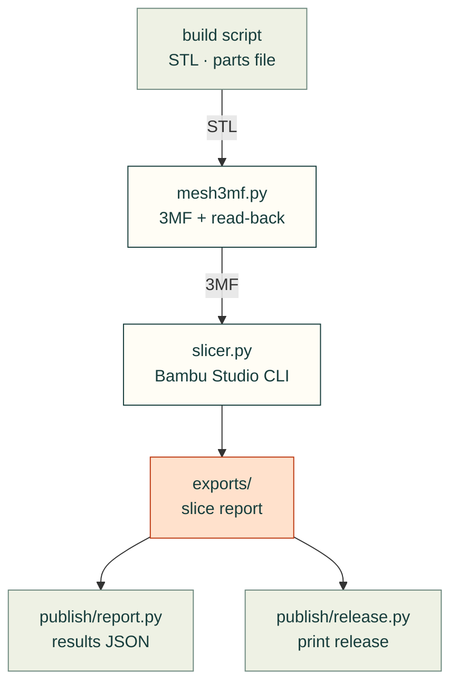

# cadagent.manufacturing

The manufacturing domain of the [topic tree](../../../docs/areas.yaml): getting from a checked model to print files and
real slicer numbers.

Arrows follow the files. `slicer.py` imports `publish/report.py`'s `load_parts` to find the parts it slices, and
`publish/report.py` and `publish/release.py` import `slicer.py` to read a current slice report; `mesh3mf.py` imports
nothing from cad-agent.

| Module | What it does |
|---|---|
| `mesh3mf.py` | A minimal 3MF writer with an independent read-back check (`cad-agent export-3mf`) |
| `slicer.py` | Real filament grams and print time from Bambu Studio's command line, run as a separate program (`cad-agent slice`) |

Related: [package map](../README.md) · [publish](../publish/README.md) (the print release) ·
[toolkit: print files](../../../docs/toolkit.md#print-files)
