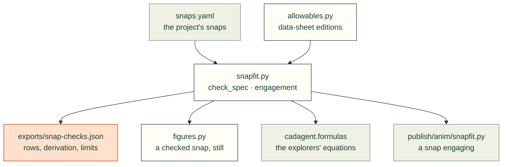

# cadagent.mechanical.compliant

Compliant features that replace separate parts: snap fits now, living hinges and flexures next. The method, the
materials and the limits are on the [snap fits and compliant features](../../../../docs/compliant.md) page.

Arrows follow the data. A project declares its snaps in a file, and `cad-agent snapfit` checks each one with
`snapfit.py`, which takes printed filaments' allowables from `allowables.py`. `figures.py` draws a checked snap still.
[`cadagent.formulas`](../../formulas/__init__.py) wraps the same equations for the site's explorers, and
[`publish/anim/snapfit.py`](../../publish/anim/snapfit.py) animates one arm engaging from `engagement()`.

| Module | What it does |
|---|---|
| `snapfit.py` | Cantilever, torsion and annular snaps by the Covestro (Bayer) closed form: strain, deflection, forces, pass/fail rows (`cad-agent snapfit`), and `engagement()`, the root strain and push to mate along the insertion |
| `allowables.py` | Printed filaments' allowable strain by print direction, from every data-sheet edition read, the cautious one per quantity |
| `figures.py` | A checked cantilever drawn still, deflected over its catch, with the result's numbers |

*The toolkit's closed-form calculator (`snapfit.py`, the Covestro method) on the stated arm: not a measurement.
Allowables from the data sheets Polymaker PolyMide CoPA V5.4 and Bambu Lab PETG-CF V3.0. Printed snaps need a test
print.*

Related: [mechanical](../README.md) · [snap fits and compliant features](../../../../docs/compliant.md) ·
[research note](../../../../research/compliant-mechanisms.md) · [animated figures](../../../../docs/animated-figures.md)
