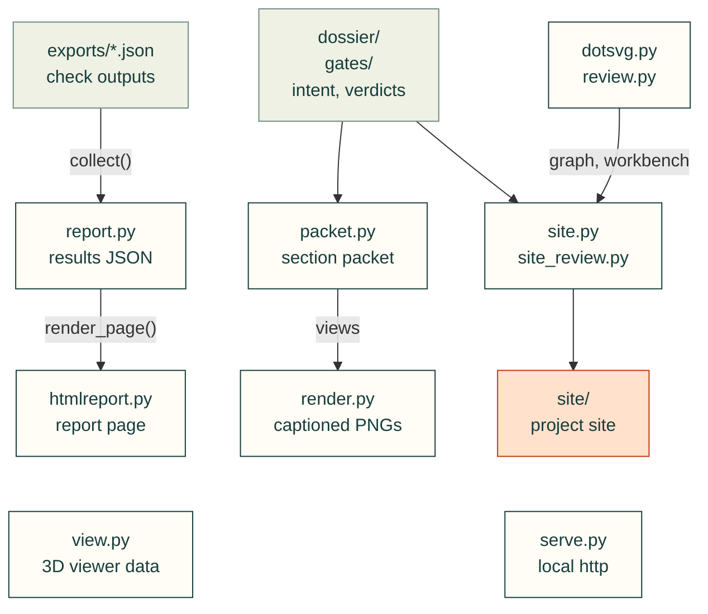

# cadagent.publish

Showing the work: results files, reports, renders, 3D views, review packets and the project site. Every page states
what was checked and what was not (CAD never proves physical fit).

Arrows follow the data, and each one between modules here is an import. `view.py` (STEP files to the 3D viewer's
data) and `serve.py` (the project over http, so pages can hand 3MF files to a slicer) stand alone.

| Module | What it does |
|---|---|
| `report.py` | Collects a project's check outputs into results JSON (schema 1.0) |
| `htmlreport.py` | A standalone HTML page for a results file |
| `render.py` | Off-screen VTK renders of CadQuery shapes and STL meshes, captioned |
| `view.py` | Every part in assembly position, for the browser viewer (`webkit/viewer.html`) |
| `dotsvg.py` | Graphviz DOT to SVG without Graphviz: a small parser and a layered layout |
| `packet.py` | The section review packet: captioned renders with the measurements first |
| `review.py` | The in-page review workbench for PCBs, housings and assemblies |
| `site.py`, `site_review.py` | The project site: progress, designs, decisions, documents; review pages, requirements, gates |
| `serve.py` | Serves a project over http so pages can hand 3MF files to a slicer |

Related: [package map](../README.md) · [web kit](../webkit/README.md) · [review packet docs](../../../docs/review-packet.md)
