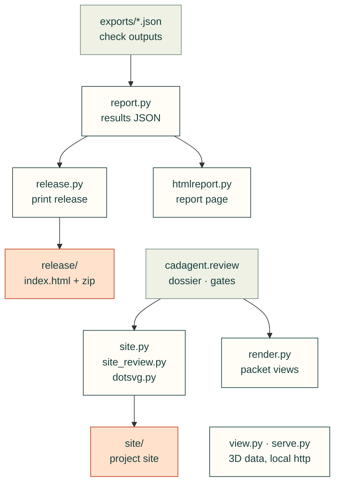

# cadagent.publish

The practice domain's publishing area of the [topic tree](../../../docs/areas.yaml): results files, reports, renders,
3D views, the project site and the print release. Every page states what was checked and what was not (CAD never
proves physical fit).

Arrows follow the data, and each one between modules is an import. `report.py` collects what the checks wrote,
`release.py` imports it and `manufacturing/slicer.py` for the print release, and `site.py` and `site_review.py` read
the [`review`](../review/README.md) package's dossier, gate verdicts and workbench. `render.py` draws the review
packets' views. `view.py` (STEP files to the 3D viewer's data) and `serve.py` (the project over http, so pages can
hand 3MF files to a slicer) stand alone.

| Module | What it does |
|---|---|
| `report.py` | Collects a project's check outputs into results JSON (schema 1.0) |
| `htmlreport.py` | A standalone HTML page for a results file |
| `render.py` | Off-screen VTK renders of CadQuery shapes and STL meshes, captioned |
| `view.py` | Every part in assembly position, for the browser viewer (`webkit/viewer.html`) |
| `dotsvg.py` | Graphviz DOT to SVG without Graphviz: a small parser and a layered layout |
| `site.py`, `site_review.py` | The project site: progress, designs, decisions, documents; review pages, requirements, gates |
| `release.py` | The print release: a browsable page of printed parts with their CAD files and the source that builds them |
| `serve.py` | Serves a project over http so pages can hand 3MF files to a slicer |

Related: [package map](../README.md) · [review](../review/README.md) · [web kit](../webkit/README.md) ·
[review packet docs](../../../docs/review-packet.md)
